# BevyCSharp devlog

What landed in BevyCSharp, by day and newest first, with the pictures taken on the way, the captures
the repository keeps under `.github/assets` and the pictures made while an item was built, kept
under `.github/assets/readings` as WebP files named by their day, each on the day its name says, and
the notes written beside them as Markdown files named the same way. A line under Done names the item
of .github/REVIEW.md or .github/REVIEW-ARCHIVE.md and the commit that closed it.

## 2026-10-25

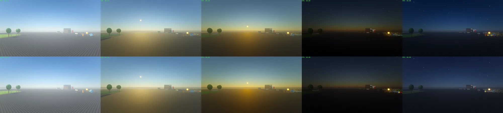
The feature test looking west at 12:00, 17:00, 17:36, 18:24 and 21:00, the sun at 45, 11, 4, minus 4
and minus 30 degrees, under the vivid look above and the day's cycle on it below, the two alike at
noon, the cycle warmer and deeper toward sunset, bluer through the twilight and a calmer navy at
night.

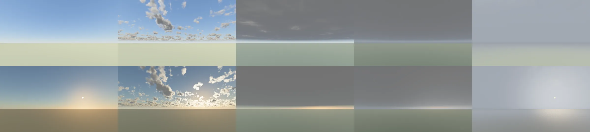
The weather crate's sky at its High tier before item 69 replaces it, few clouds, partly cloudy,
overcast, storm and fog left to right, at noon above and near sunset below, the references the
engine's own fog and clouds are read against.

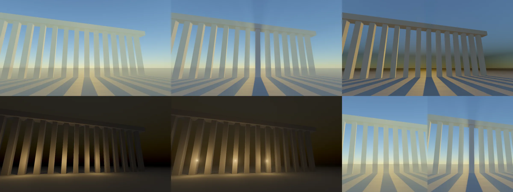
A colonnade between the camera and a sun 8 degrees up in fog seen to 95% at 160 meters, the fog in
closed form, in froxels at High and in Bevy's own volumetric fog above, and by night under three
lamps in closed form and in froxels below, the lamps glowing in the froxels, with the middle of the
day pair beside them, where the pillar standing between the eye and the sun casts its shadow down
the whole way and the fog there takes the sky's blue alone.

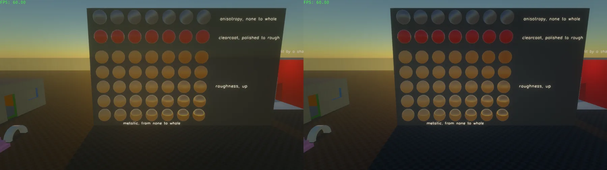
The feature test's render gallery at 17:36 with the fog in closed form on the left and in froxels at
Medium on the right, the fog in the gallery wall's shadow before it lit by the sky alone and bluer.

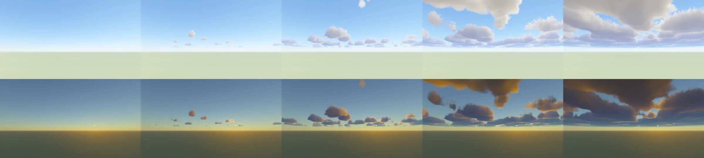
The engine's clouds at coverages of 0.15, 0.3, 0.5, 0.7 and 0.9, at noon above and with the sun four
degrees up below, from a clear sky through fair weather heaps to a broken sky.

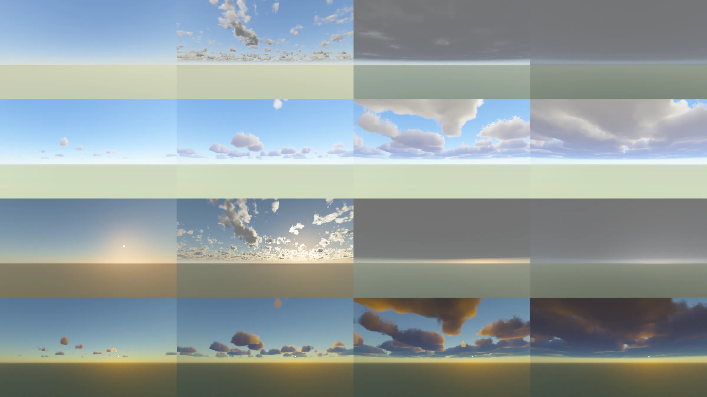
The weather crate's few clouds, partly cloudy, overcast and storm at its High tier in the first and
third rows, at noon and near sunset, and the engine's clouds at High under the same sky at coverages
of 0.3, 0.5, 0.75 and 1 below each, rounded heaps with worn edges, white by day and lit gold from
below at sunset where the crate's are small and gray and its overcast a flat deck.

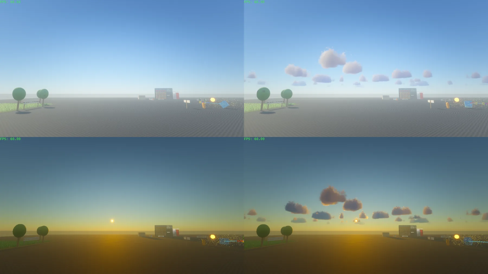
The feature test's hub at 14:00 and 17:36 under no cloud on the left and the engine's clouds at a
cover of 0.4 on the right, white heaps by day and at sunset dark with gold lit tops and a bright
edge on the one before the sun.

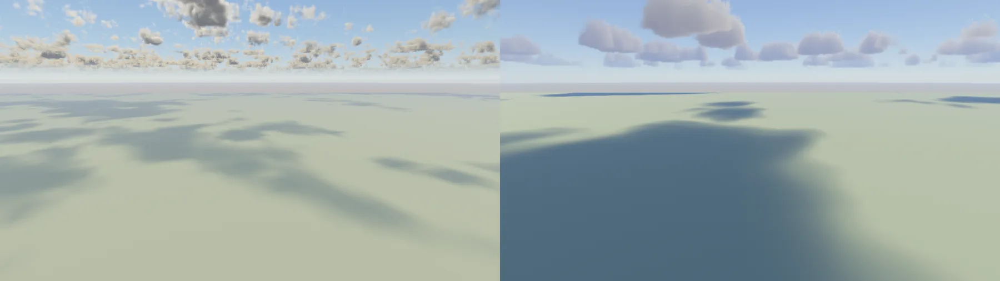
The ground seen from 300 meters up under the weather crate's partly cloudy sky and its cookie built
on the CPU on the left, and under the engine's clouds at a coverage of 0.5 and their shadow built on
the GPU on the right, the shade under a cloud lit by the sky alone and blue, soft at its edges and
drifting with the clouds.

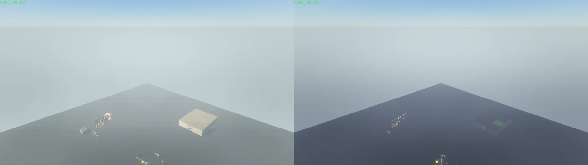
The feature test's hub from 90 meters up at 14:00 under no cloud on the left and in a cloud's shadow
at a cover of 0.5 on the right, the ground and the froxels' fog over it lit by the sky alone.

The weather crate's clear sky at midnight on the left, and the engine's night sky by its sky clock
at midnight and at 20:30, under Bevy's atmosphere lit by a gibbous moon, the stars fine and few
bright, the galaxy's band crossing the sky with its dark lanes, and the moon a small disc lit from
the sun's way.

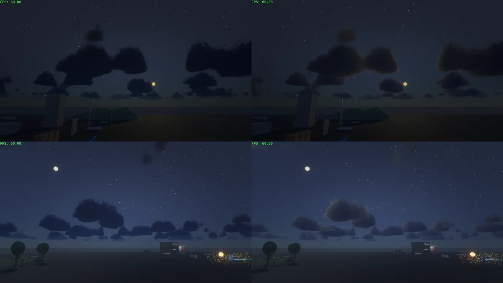
The feature test's sky by the clock at 19:12 looking east as the full moon rises and at 03:00
looking west as it sets, with the clouds lit by the brightest light before the change on the left,
the sun set behind the planet leaving them black, and by the brightest light through the air after
it on the right, moonlit gray and warm toward the low moon.

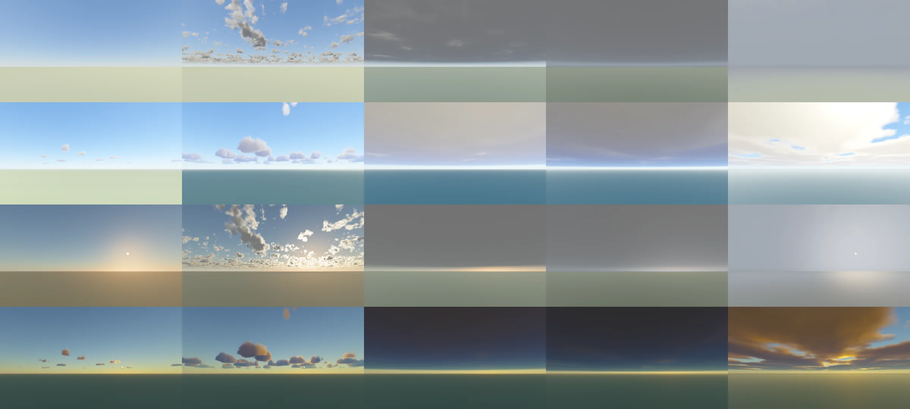
The weather crate's few clouds, partly cloudy, overcast, storm and fog presets at noon in the first
row and in the evening in the third, against the engine's weather on the same presets in the second
and fourth, its heaps rounded, its overcast and storm a flat deck, its fog a broken deck over a
misty distance, and the ground under the decks lit blue by Bevy's sky light, which does not see the
clouds.

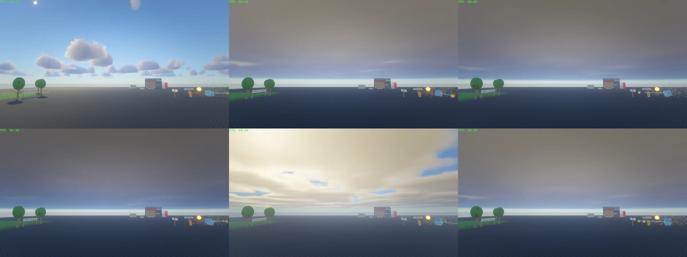
The feature test's hub at 15:00 under the engine's weather, partly cloudy, overcast and rain in the
top row and storm, fog and snow below, each taken at once with sky.weather, the decks a darker gray
as the weather worsens and the fog's deck thinning to a soft broken edge.

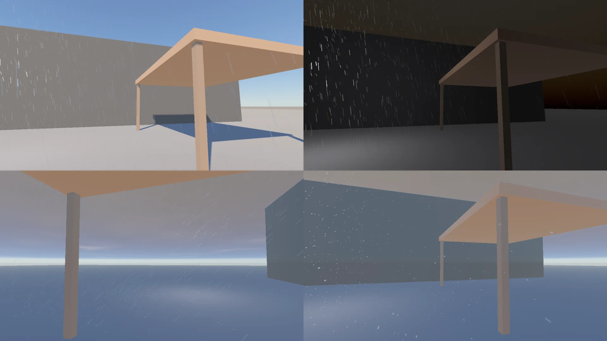
Rain at 0.8 in a test scene under a clear afternoon sky and lit by a lamp at dusk above, and below,
the Rain weather's storm seen from under a roof, the air beneath it clear and the rain blowing past
its edges, and the Snow weather's flakes, all drawn after temporal antialiasing.

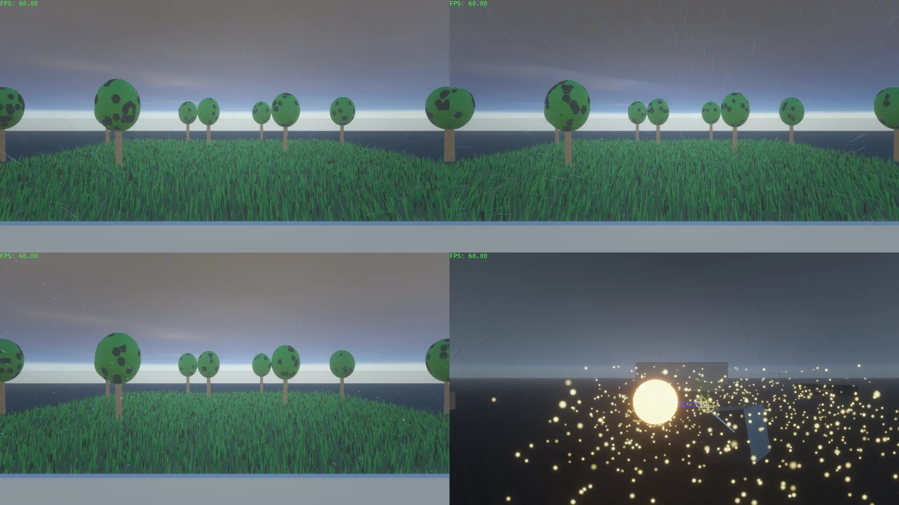
The feature test's meadow at 15:00 under the engine's Rain, Storm and Snow weathers taken in that
order, the storm's streaks drawn toward where its wind blows and the snow falling at once where the
rain had been, and the hub in rain at 21:30 with the drops faint in the dark, the ground under the
decks lit blue by Bevy's sky light, which does not see the clouds.

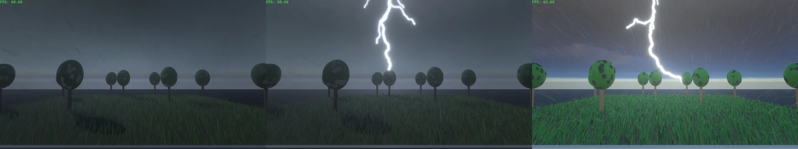
The feature test's meadow under its Thunderstorm weather at 22:00 before a strike and three frames
after one 650 meters off, the bolt standing over the trees, and at 16:00 with a strike 600 meters
off, its foot behind a tree.

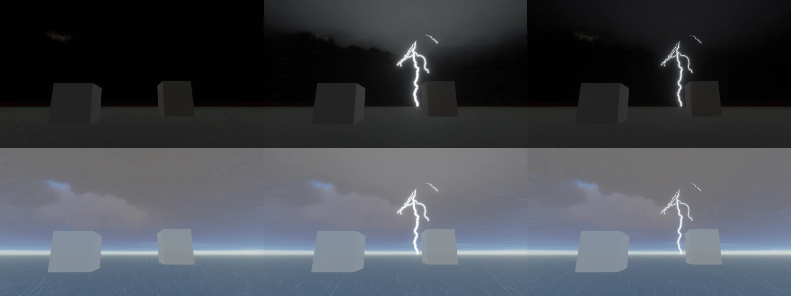
A test scene under the Thunderstorm weather at night above and by day below, before a strike 900
meters off, three frames into its flash with the clouds glowing about it, the rain lit and the bolt
drawn from the clouds' base to the ground, and twelve frames in as the glow dies and the bolt
flickers on, its foot behind the nearer block.

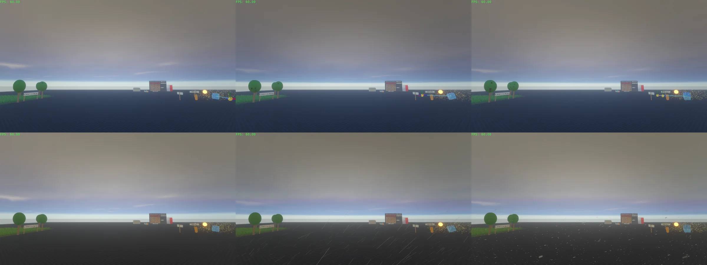
The feature test's hub at 15:00 under its Overcast, Rain and Snow weathers, above with the sky
lighting filtered from the clear sky, the ground lit blue-teal under the decks, and below with the
clouds laid over the sky the lighting is filtered from, the ground gray and the flakes white.

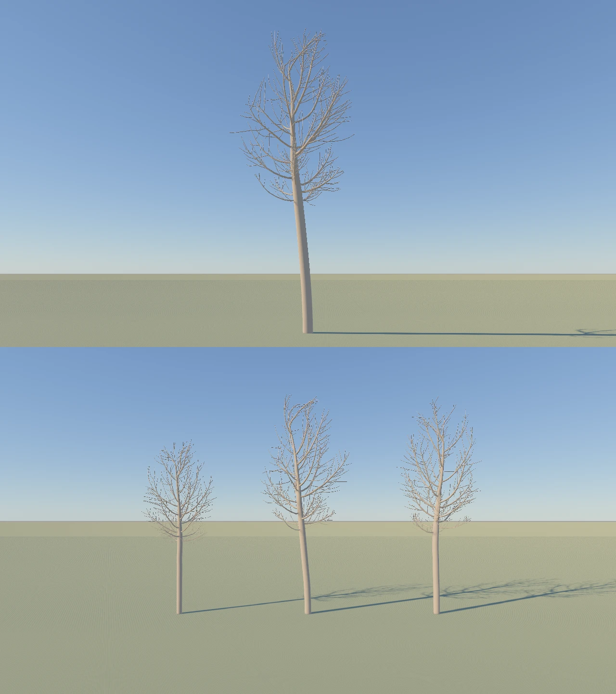
A tree grown by seed 2 from controls near the paper's quaking aspen, bare of leaves under an
afternoon sun, its trunk bare to four tenths of its height and its branches turning up into a narrow
crown, and below, seeds 1, 2 and 3 of the same species standing side by side.

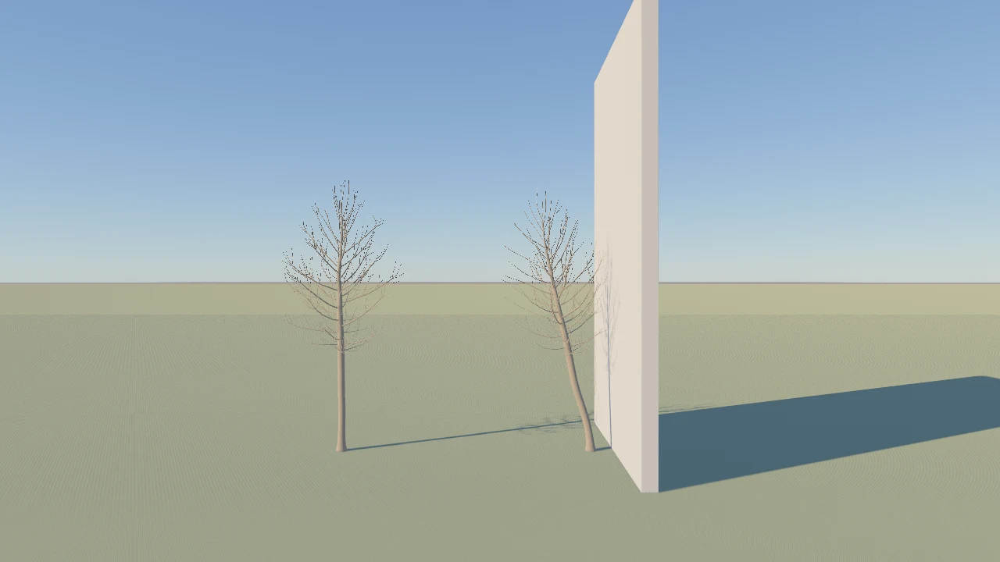
The quaking aspen of seed 5 grown in the open on the left and a meter from a wall on the right,
where the wall takes the sky from the crown's side next to it and the tree stands away from it,
trunk and crown.

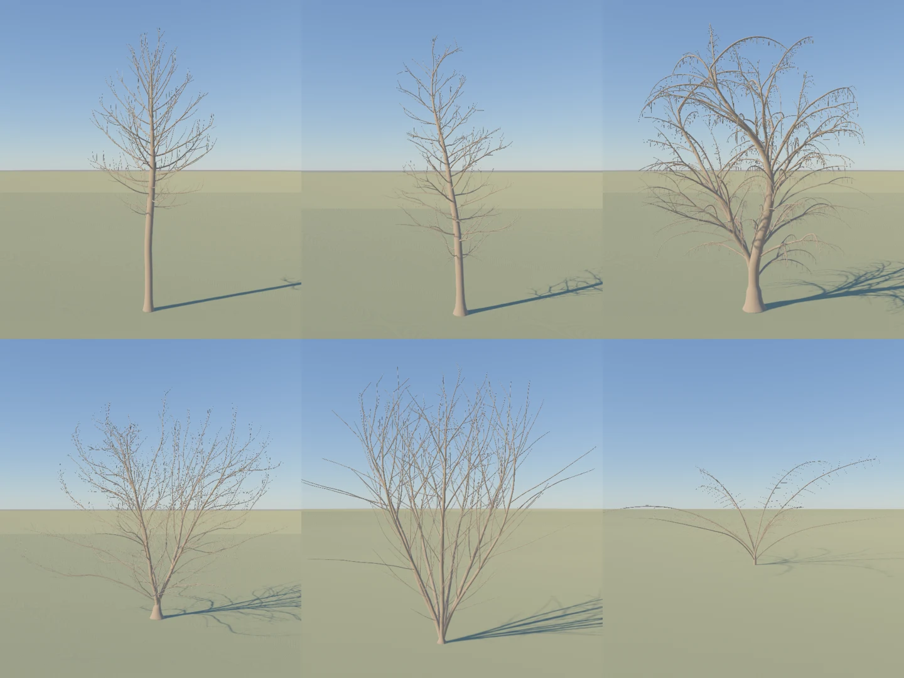
The library's six species grown bare by seed 2 under the shadow grid, each framed to its own size,
above the quaking aspen, the black tupelo and the weeping willow of the paper's appendix, and below
its California black oak, the bush and the fern.

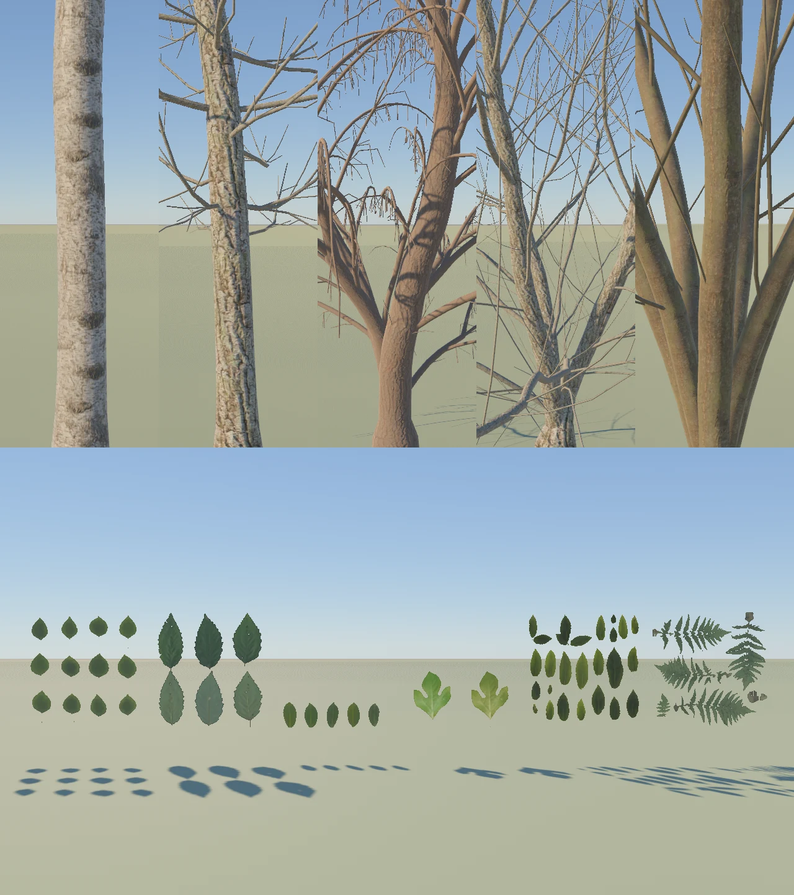
The collection's first sets drawn through Bevy's loader from their BC7 and BC5 files, above each
bark on its preset's trunk, the quaking aspen's silver birch, the black tupelo's broadleaf, the
weeping willow's own, the oak's broadleaf and the bush's hornbeam, and below the six leaf atlases on
cards cut out by their opacity, the silver birch, the alder, the willow, the shingle oak, the
hornbeam and the fern.

Six trees grown from controls near the paper's quaking aspen, its leaves left out, by seeds 1 to 6,
as `dotnet test BevyCSharp.Tests/BevyCSharp.Tests.csproj --filter AnAspenKeepsWithinItsTriangles
--logger "console;verbosity=detailed"` prints them. The height is the species' 13 meters with three
either way, the spread is the farthest point from the trunk's axis, the trunk's radius is at the
ground, and the triangles are those of the bare stems, from twelve sides on the trunk down to three
on the thinnest twigs.

| Seed | Points | Tips | Height | Spread | Trunk's radius | Triangles |
|---|---|---|---|---|---|---|
| 1 | 1165 | 323 | 12.1 m | 2.6 m | 18.0 cm | 12976 |
| 2 | 1142 | 332 | 15.3 m | 3.9 m | 22.3 cm | 12824 |
| 3 | 1153 | 341 | 14.8 m | 3.2 m | 21.4 cm | 12922 |
| 4 | 1144 | 337 | 10.4 m | 2.3 m | 15.2 cm | 12818 |
| 5 | 1108 | 309 | 10.6 m | 2.4 m | 15.7 cm | 12472 |
| 6 | 1046 | 305 | 13.1 m | 3.0 m | 19.4 cm | 11868 |

The six presets grown bare by seeds 1 to 3, as `dotnet test BevyCSharp.Tests/BevyCSharp.Tests.csproj
--filter APresetStandsAsTallAsThePapersAndAsWideAsItsPlate --logger "console;verbosity=detailed"`
prints them. The paper's height is its scale with its variation either way times the trunk's
length, the width is the mean of the tree's extents along X and along Z, and the plate's width over
height was read off the paper's plates 1, 2, 5 and 7, the bush's and the fern's being the library's
own aims. The test holds each preset's mean over the three seeds to three tenths either way of its
plate.

| Preset | Seed | Paper's height | Height | Width | Plate's width over height | Width over height |
|---|---|---|---|---|---|---|
| quaking aspen | 1 | 10 to 16 m | 13.9 m | 6.3 m | 0.45 | 0.46 |
| quaking aspen | 2 | 10 to 16 m | 16.9 m | 7.9 m | 0.45 | 0.47 |
| quaking aspen | 3 | 10 to 16 m | 15.9 m | 7.8 m | 0.45 | 0.49 |
| black tupelo | 1 | 18 to 28 m | 23.5 m | 11.5 m | 0.55 | 0.49 |
| black tupelo | 2 | 18 to 28 m | 28.6 m | 14.2 m | 0.55 | 0.50 |
| black tupelo | 3 | 18 to 28 m | 28.4 m | 13.9 m | 0.55 | 0.49 |
| weeping willow | 1 | 8 to 16 m | 13.1 m | 10.4 m | 0.90 | 0.79 |
| weeping willow | 2 | 8 to 16 m | 17.0 m | 14.0 m | 0.90 | 0.83 |
| weeping willow | 3 | 8 to 16 m | 16.7 m | 13.1 m | 0.90 | 0.79 |
| California black oak | 1 | 0 to 20 m | 7.8 m | 8.5 m | 1.05 | 1.10 |
| California black oak | 2 | 0 to 20 m | 18.6 m | 22.9 m | 1.05 | 1.24 |
| California black oak | 3 | 0 to 20 m | 15.6 m | 20.4 m | 1.05 | 1.31 |
| bush | 1 | 1.1 to 1.9 m | 1.6 m | 1.6 m | 1.00 | 1.02 |
| bush | 2 | 1.1 to 1.9 m | 1.9 m | 2.0 m | 1.00 | 1.03 |
| bush | 3 | 1.1 to 1.9 m | 1.8 m | 1.9 m | 1.00 | 1.09 |
| fern | 1 | 0.4 to 1.1 m | 0.7 m | 1.8 m | 2.50 | 2.51 |
| fern | 2 | 0.4 to 1.1 m | 0.8 m | 2.1 m | 2.50 | 2.51 |
| fern | 3 | 0.4 to 1.1 m | 0.8 m | 1.8 m | 2.50 | 2.42 |

Held against the plates, the aspen stands as plate 1 (r) does, a tall trunk bare to four tenths of
its height under a narrow crown whose branches turn up at their tips. The tupelo carries its trunk to
the top with level branches the whole way up, as plate 2 (b) does, though more sparsely, since its
finest level grows only where it finds light and room. The willow's limbs arch out and back down as
plate 7 (b)'s pruned willow's do, its long whips stopped at the envelope. The oak parts low into
crooked limbs and a crown as broad as it is tall, a little broader than plate 1 (b)'s.

The collection's first sets, the six presets' barks and leaves, as `build/textures.py` imports them
from `.vegetation/` and writes their sizes and errors into `textures.json`. A set's size is its
albedo's, the normal and the surface being half of it either way, its bytes on disk are its three
files', and each error is the top level's against what it was encoded from.

| Set | Kind | Albedo | On disk | Albedo error | Normal error | Surface error |
|---|---|---|---|---|---|---|
| silver-birch-bark | bark | 512 by 512 | 443 KB | 44.7 dB | 42.3 dB | 45.1 dB |
| broadleaf-bark | bark | 256 by 1024 | 396 KB | 42.3 dB | 38.9 dB | 51.1 dB |
| weeping-willow-bark | bark | 256 by 1024 | 421 KB | 45.5 dB | 40.0 dB | 48.6 dB |
| hornbeam-bark | bark | 256 by 512 | 220 KB | 43.6 dB | 45.9 dB | 47.9 dB |
| silver-birch-leaves | 12 leaves | 512 by 512 | 298 KB | 46.1 dB | 52.2 dB | 44.3 dB |
| weeping-willow-leaves | 5 leaves | 1024 by 256 | 328 KB | 31.7 dB | 50.1 dB | 45.5 dB |
| hornbeam-leaves | 20 leaves | 512 by 512 | 391 KB | 31.3 dB | 42.9 dB | 38.8 dB |
| shingle-oak-leaves | 2 leaves | 512 by 256 | 153 KB | 32.2 dB | 48.9 dB | 45.6 dB |
| red-alder-leaves | 6 leaves | 512 by 512 | 306 KB | 35.7 dB | none | 42.2 dB |
| fern-leaves | 6 leaves | 512 by 512 | 390 KB | 30.3 dB | 48.5 dB | 39.9 dB |

The collection is 3.3 MB of its 32, and a species' bark and leaves are 549 KB for the oak to 749 KB
for the willow. The quaking aspen takes the silver birch's, the black tupelo the broadleaf bark
with six alder leaves, their fronts and backs, the weeping willow its own bark with the green row
of its sheet, the oak the broadleaf bark with the shingle oak's two leaves, the bush the hornbeam's
and the fern its five fronds, beside which its atlas gives a sixth box for a scrap of a stalk. Every
set holds 512 by 512 texels or fewer, the willow's leaves 1024 by 256 to keep their row whole.

Everything else under `.vegetation/` stayed out, the other trees' barks and leaves, the branch and
cap cards, the alder's two old leaves and the other scans, the grass, the ground, the ivy and the
flowers. The leaf albedos' error is the largest, since a block that holds a leaf's edge holds both
its color and the background's under one line of endpoints.

Done that day

- Item 64 at `5041dda3`. The sky is photoreal after Hillaire's 2020 atmosphere, keeping 3DEngine's
  vibrance.
- Item 69 at `ff5fa5e9`. The weather is the engine's own, lit by the atmosphere, and the vendored
  weather crate leaves.
- Item 71 at `d8ecd271`. A frame point after tonemapping is ordered against FXAA, SMAA and CAS.
- Item 72 at `6795478f`. The feature test's sample behaviors go from the source.
- Item 73 at `ff5fa5e9`. A capture shard's container reaps its children, and the four idle shards
  go.
- Item 74 at `d151e0cc`. A texture collection for the vegetation, imported from free sources, small
  on disk and on the GPU.

## 2026-10-24

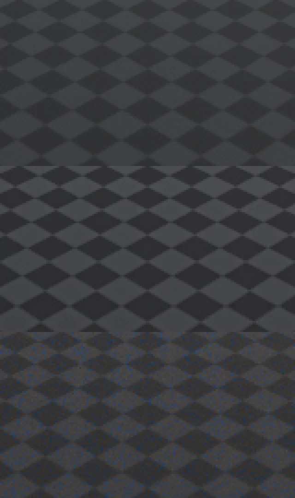
The checkered ground far off in three crops, the reference mean, the denoiser's frame and a grainy
one, the reading that moved the demodulation to the diffuse color plus the specular reflectance
(item 54).

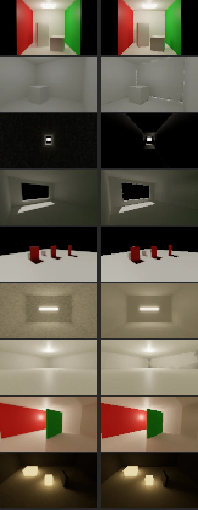
The nine bounce rooms at High beside their references once the environment's sky had come in and
before the glossy term, the readings item 51's last commit was measured against.

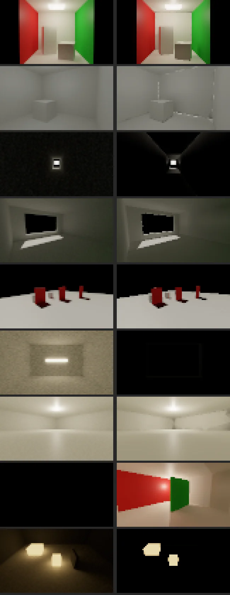
The nine bounce rooms at 160 by 90, each path-traced reference on the left and global illumination
at High on the right as item 51's reference first read them, the strip's and the glowing blocks'
rooms dark before their emitters were carried and the carried lamp's reference dark before its bulb
stopped blocking the shadow rays.

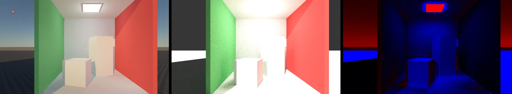
The feature test's Cornell box at High beside the picture gi.reference traced of it at 256 paths a
pixel and gi.compare's difference, blue where the box reads under the reference and red where over,
the first reading of item 51's reference in a room of the feature test.

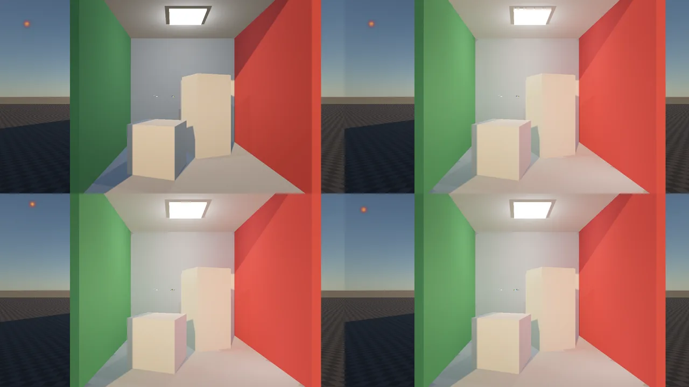
The same box in four captures taken for item 51's pass, the field's contact shadows with global
illumination off at the top left and then Low, Medium and High.

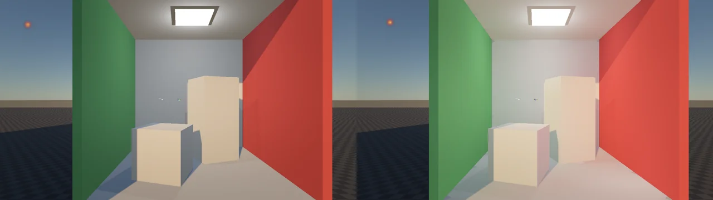
The feature test's Cornell box with global illumination off on the left and at High on the right,
the walls' red and green carried onto the blocks and the floor by item 51's pass.

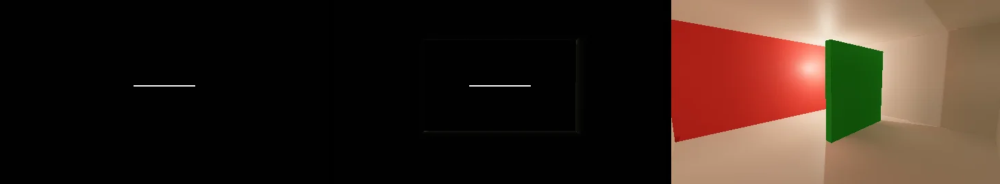
The strip's room with global illumination off and at High and the carried lamp's room at High, at
480 by 270, read for item 51's reference while the strip's light was not yet carried.

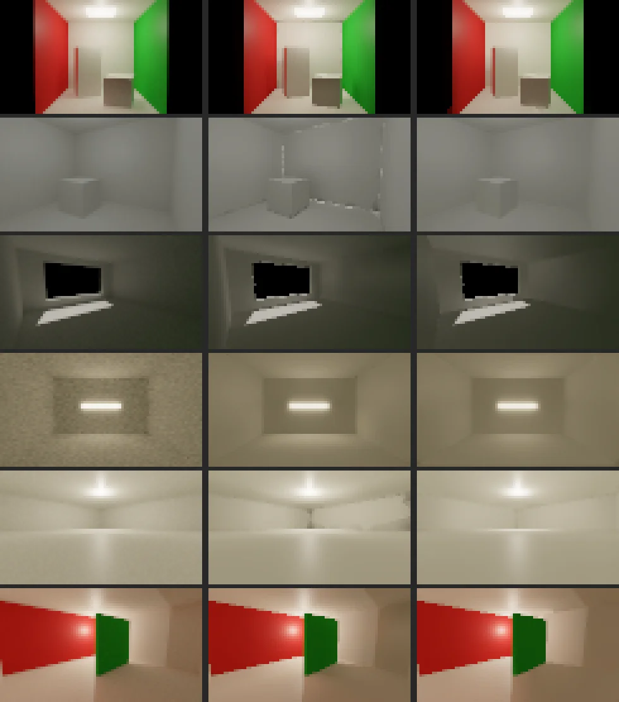
The same six rooms at High, the screen probes' tiles eight pixels a side, the Cornell box's floor
reading 3.5% over its reference with them where 12.8% without.

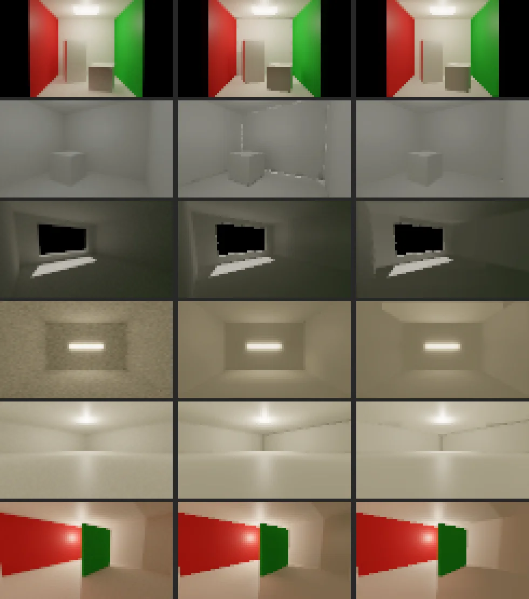
Six bounce rooms at Low at 160 by 90, the reference, global illumination with the screen probes off
and with them on, the probes taking away the seams of the thin walls' room and bringing blotches the
size of their tiles of sixteen pixels to the window's, the strip's and the carried lamp's rooms.

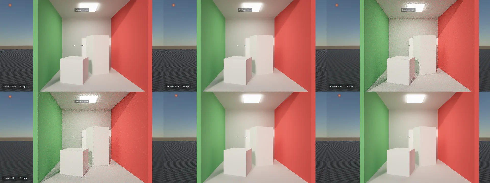
Six shots of the feature test's Cornell box under Solari's ray-traced lighting taken with item 54's
denoiser and without it, the grain on the walls and the floor the frames without.

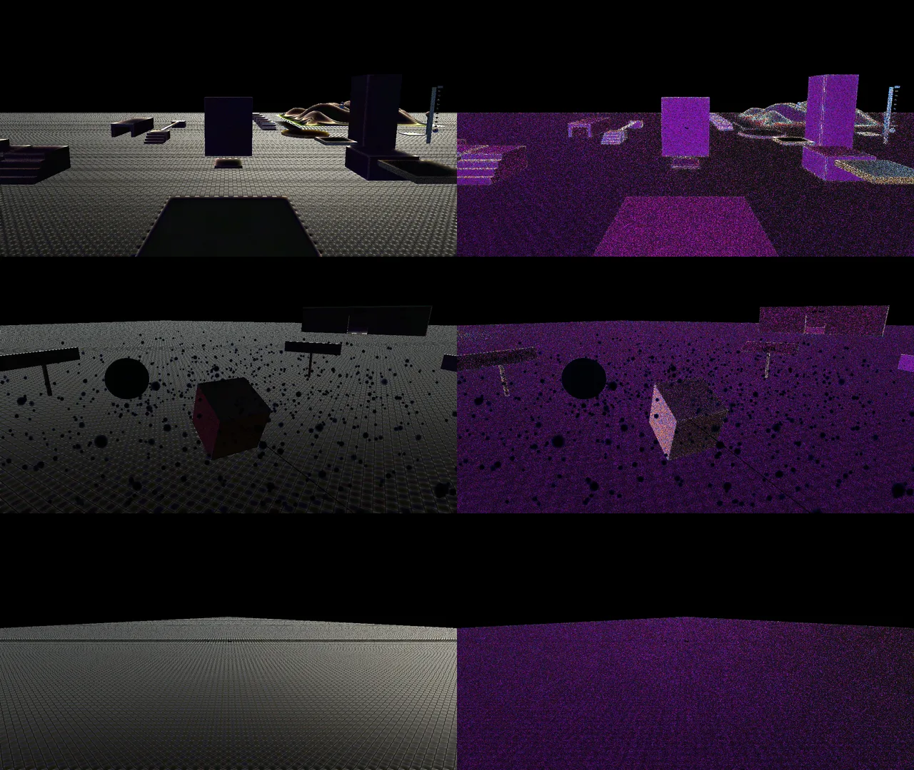
Item 54's denoiser read in three scenes against each scene's reference, each row the difference of
the denoised frame on the left and of a grainy frame on the right.

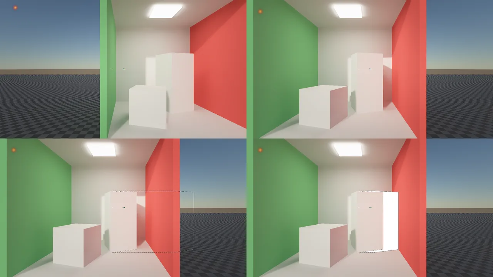
A strafe of the feature test's camera read for item 54's denoiser, its first and last frames above,
and below the last frame with the pixels the strafe uncovered within its last 30 frames in red and
within its last 8 in blue, the masks the history's recovery was measured in.

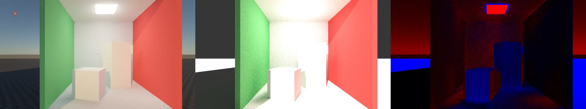
The feature test's Cornell box at High, its path-traced reference and the difference, the reading
whose lamp panel read 40,053 against the reference's 49, which item 60 traced to the emissive's
exposure weight the bridge never set.

The floor about the foot of an edge a stone wall's two halves meet along, a glowstone beyond it, at
eight times its brightness, the fan of light through the edge before the field's resolve held the
cells about it inside and none after, 15 sRGB levels at the brightest where 3 with the edge closed
by a block.

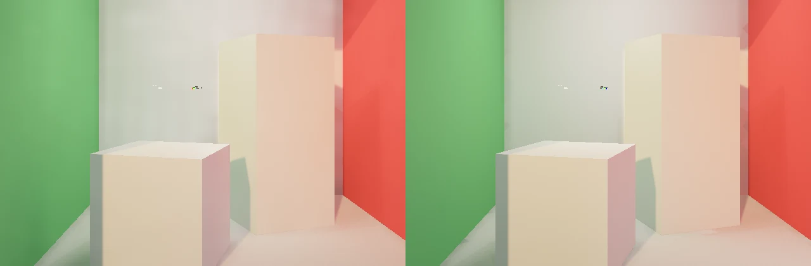
The feature test's Cornell box at High with the screen probes on the left and left out on the right,
the probes darkening the blocks' feet and the corners and leaving streaks a tile wide on the back
wall, the blotches 3DEngine names as a term.

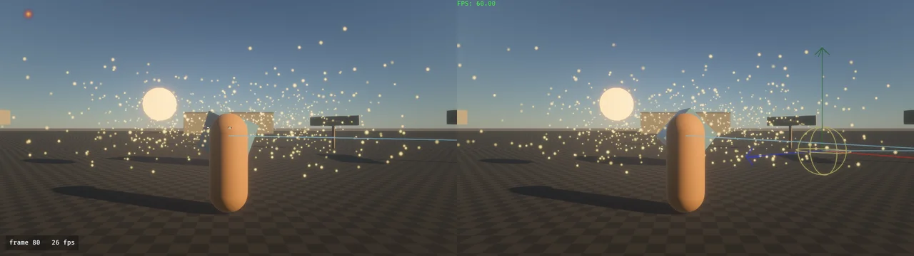
The feature test's hub before item 63 on the left, a sprite throbbing at the top left, the frame's
count at the bottom left and the scene's gizmos drawn a second time as marks at the middle by the
sprite's 2D camera, and after it on the right, the frame's rate in green at the top left and the
middle clear.

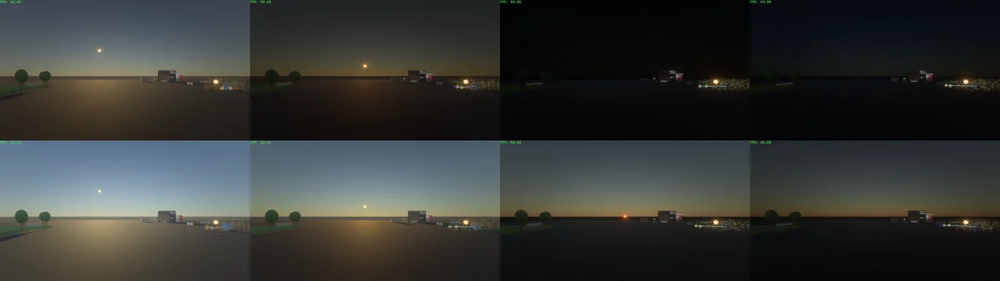
The feature test looking west at 17:00, 17:36, 18:00 and 18:12, above as the day's curve dimmed the
sun to nothing at the horizon and below with the sun given as above the air and the atmosphere
dimming it, the sunset's band and the sun's red disc back.

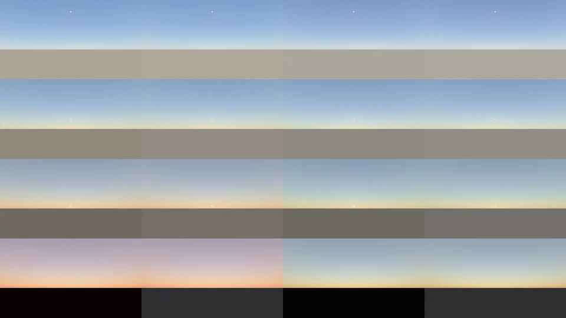
The sky toward the sun at 30, 8, 2 and -2 degrees, each row Bruneton's amounts from Bevy's lookup
textures and raymarched, then the Atmosphere Rendering Parameter Calculator's the same two ways, the
lookup textures within a level of the raymarch and the calculator's sunset gold under a gray green
where Bruneton's is orange under purple.

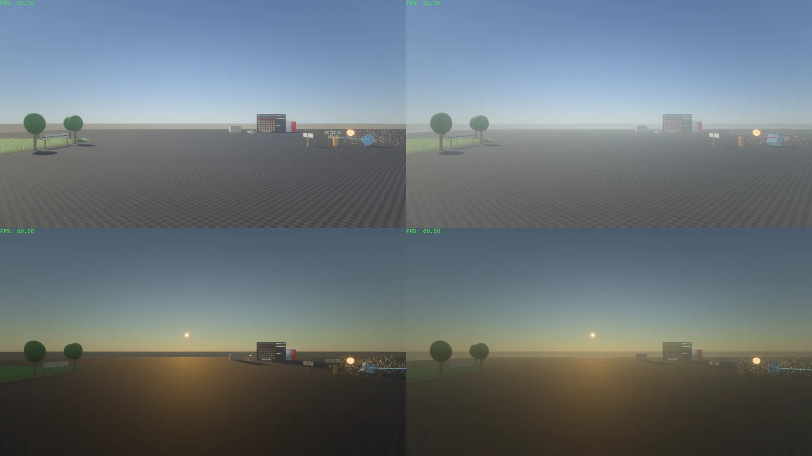
The feature test along its far ground at 14:00 above and 17:36 below, on the left with the
atmosphere's even ground under the horizon and the level's edge standing against it, and on the
right under the sky's fog at 700 meters, the band under the horizon in the horizon's color and the
far ground fading into it, warm toward the setting sun.

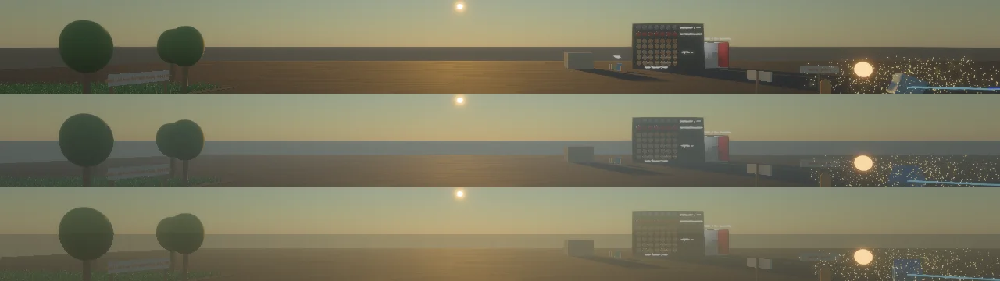
The horizon at 17:36 without fog, then under fog whose color was read from the sky's light through a
wide lobe that took in the dark ground under the horizon and left a blue gray band, then read nearly
sharp, the band and the haze gold as the sky above them.

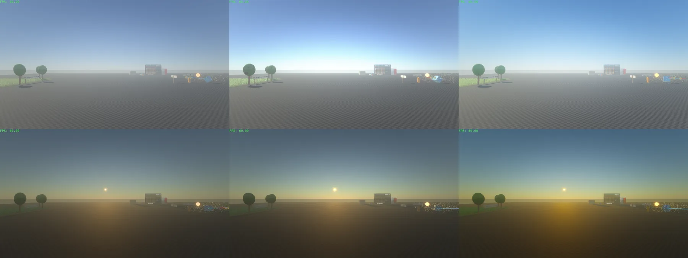
The feature test along its far ground at 14:00 above and 17:36 below, under Bevy's TonyMcMapface on
the left, the engine's curve with its knee in the middle, and the vivid look 3DEngine's block game
is graded by on the right, the sky deep blue at the top by day and the setting sun's light gold on
the ground.

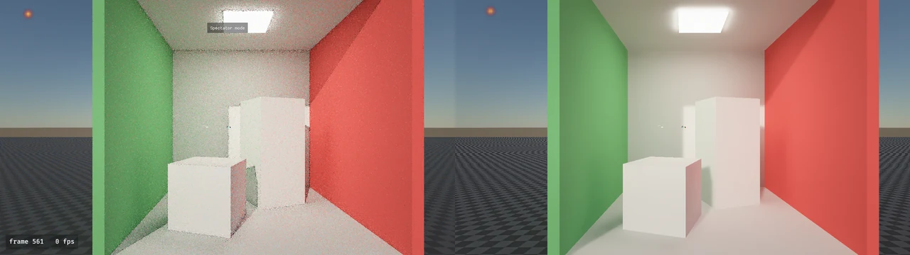
Item 51's second part adds global illumination's light to Bevy's surfaces through a pass after the
opaque geometry that takes back Bevy's ambient diffuse from the G-buffer and adds the surface's
diffuse color times the probes' light, with a sky over a ground past the last cascade, the probes'
sky at the 0.45 of an ambient light that Bevy's ambient term returns, Render.SetGlobalIllumination
public, a row on the feature test's graphics page, tests of a red wall tinting a white block's side
and an open floor reading as Bevy's ambient light leaves it, the costs read in a Cornell box, and
the denoiser's picture in the ray tracing guide beside the review's readings. (`07863068`)

Done that day

- Item 51 at `c230300b`. Radiance cascades over the field, 3DEngine's second phase, lighting Bevy's
  surfaces through an additive pass (Decision 51).
- Item 52 at `f0ae14ec`. The screen's probes, the glow lights and the counted meshes, 3DEngine's
  third phase and its mends of 2026-10-21 (Decision 51).
- Item 54 at `97440a1d`. A denoiser over Solari's lit result, so the ray-traced tier's picture is
  clean (Decision 52).
- Item 59 at `750c9cbc`. The denoiser's node comes down from 3.6 ms at 1080p, read stage by stage
  first.
- Item 60 at `36d783bf`. The deferred G-buffer keeps the emissive's exposure.
- Item 61 at `eca6e651`. No running sentence holds a colon, across the documents, the comments and
  the scripts.
- Item 62 at `ce186327`. The open floor test reads the same light every run.
- Item 63 at `30362cf2`. The feature test's HUD is clean, a green frame rate in a corner and nothing
  else over the view.

## 2026-10-23

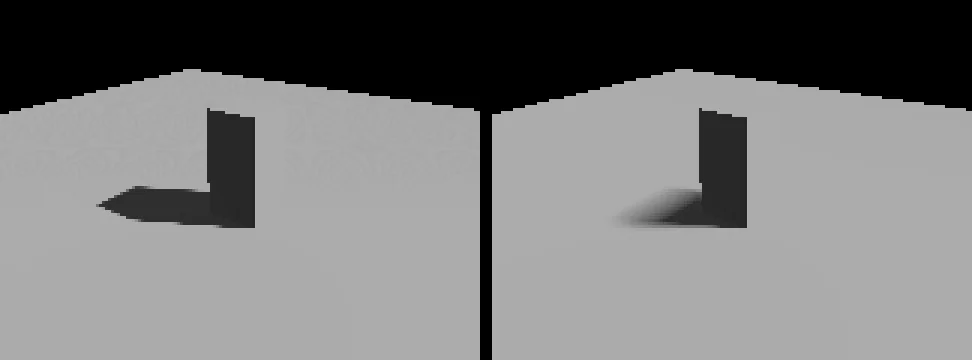
The scene's distance field read as a pair, a box's field mapped and traced (item 50).

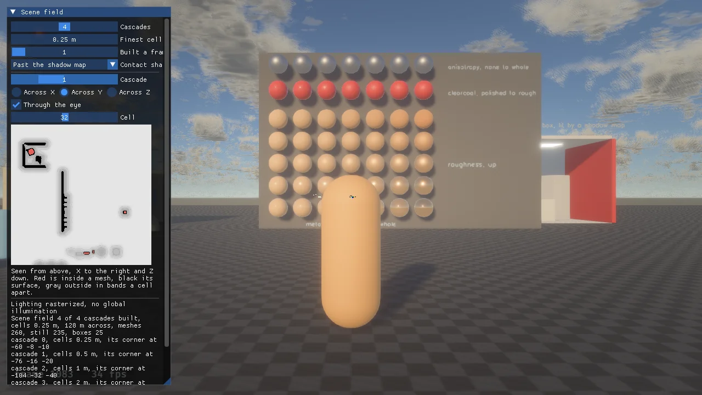
The field's window in the feature test, the cascades' cells over the room (item 50).

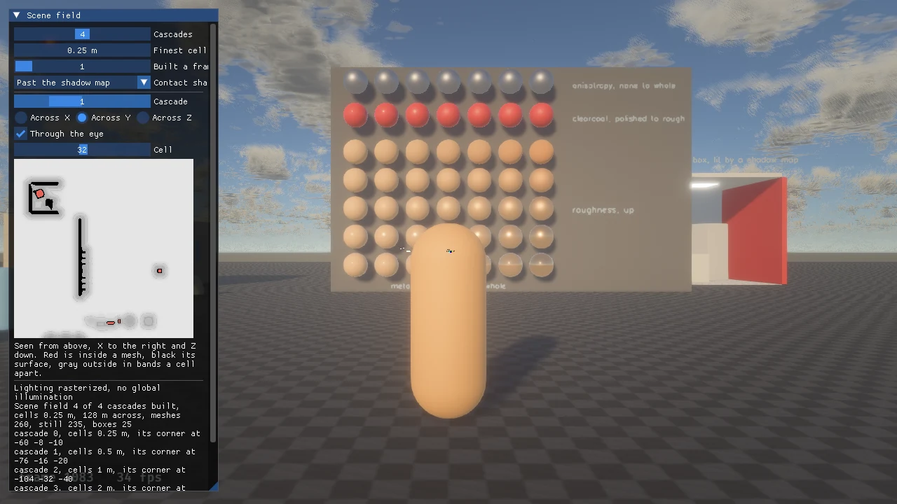
The scene's distance field darkens each directional light where it closes a surface off, past the
shadow map by default, by taking back the light Bevy gave from the camera's G-buffer in a picture of
floats, and draws its settings and a slice across a cascade in a window of its own, which the
feature test shows at its gallery. (`d2e6ef81`)

Done that day

- Item 43 at `cd05d9a2`. Modeling operations on faces and edges, Blender's kinds (Decision 46).
- Item 44 at `cd05d9a2`. Modifiers, a stack applied at the build and never baked until asked
  (Decision 46).
- Item 45 at `ba8111fb`. What is modeled is exported for Blender and imported from it (Decision 46).
- Item 49 at `e1b08124`. F1 hides the interface, F3 shows a debug overlay like the newest
  Minecraft's with sections a program adds, and Shift+F3 the profiler with it (Decision 50).
- Item 50 at `d2e6ef81`. The scene's distance field, 3DEngine's first phase of its global
  illumination, through the bridge (Decision 51).
- Item 55 at `135e43b5`. The README's animated capture of Swarm goes.
- Item 56 at `fda2f62e`. The bridge's Slang modules give their names plainly, as 3DEngine's do, with
  no `bcs_*::` before them (Decision 56).
- Item 58 at `66e2b067`. The cheat sheet's headers are 3DEngine's, plain group headings and no sub-
  heading a type (Decision 58).

## 2026-10-21

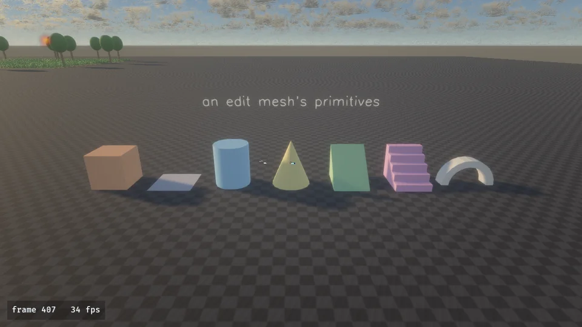
The edit mesh's primitives in the drive, a box, a sphere, a cylinder, a cone, a wedge and an arch
(item 38).

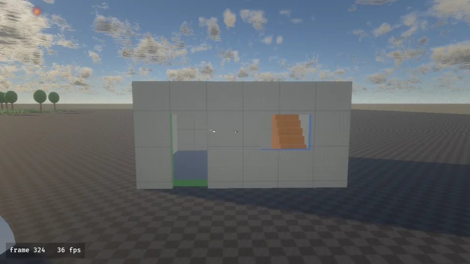
A room blocked out in the prototype materials with the grid image of a meter's cell (item 39).

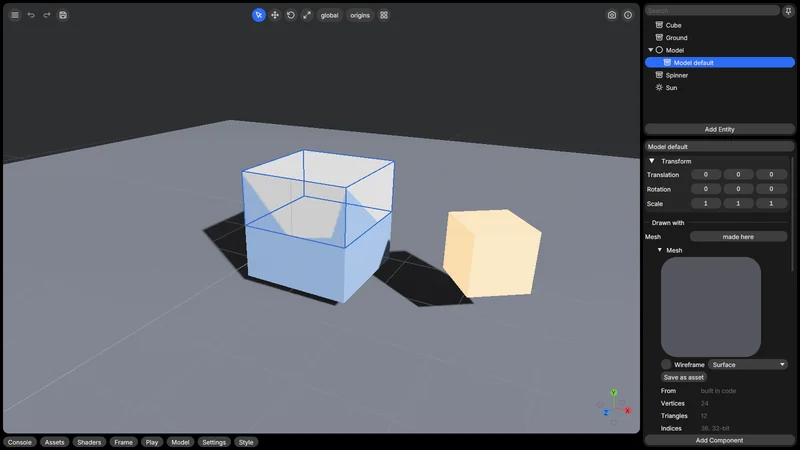
The modeling window in the editor with its picking, its drag and the Model tab (item 40).

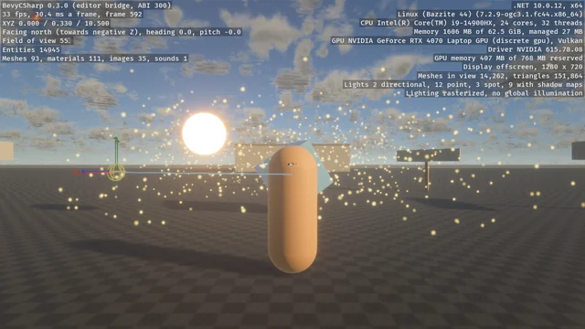
The F3 overlay over the feature test, the frame's strip and its sections (item 49).

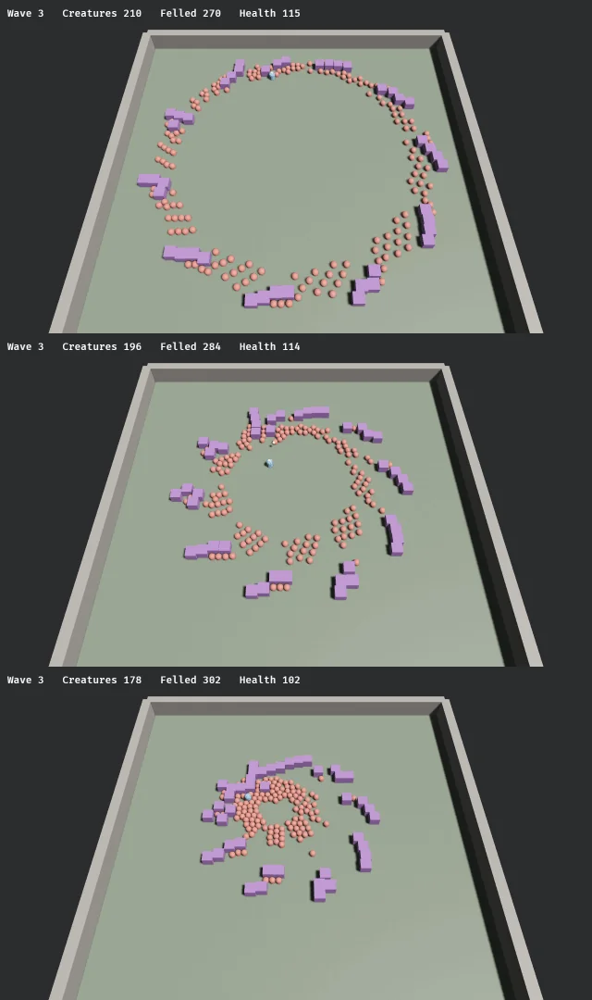
Swarm's arena across three waves, the game played by its script.

The room built through the model commands from the terminal alone (item 40).

Texture coordinates by projection on a checker and a wood grain (item 41).

A textured cube in the modeling window after the texture coordinates landed (item 41).

Blockout, a level of three rooms, a corridor and stairs between two floors blocked out from one
recipe, is walked through the character controller and reshaped from the modeling window on Tab, and
the booleans take a solid primitive's line as the cut does. (`09fc95dd`)

Done that day

- Item 38 at `08d03b4d`. An edit mesh a program shapes by operations, with a recipe that rebuilds
  it, built into what the engine draws and collides with (Decision 46).
- Item 39 at `bfe1fc63`. Grid prototyping, materials that show a meter, texture coordinates aligned
  to the world, and openings cut by booleans (Decision 46).
- Item 40 at `bee54e98`. The modeling commands, so a level is blocked out from the terminal, and a
  window in the game to shape by hand (Decision 46).
- Item 41 at `fc63b7ba`. Texture coordinates shaped and textures given to faces (Decision 46).
- Item 42 at `09fc95dd`. A game that is a level blocked out with the tools, Blockout (Decision 46).
- Item 46 at `585497f1`. An animated capture of a run, frames taken at an interval and written as
  one file, and one made from captures on disk (Decision 48).
- Item 47 at `3d045110`. F2 takes a screenshot in every program, to a screenshots folder beside it
  (Decision 49).
- Item 48 at `5f051299`. The render recovery test reads its error count until it is one or a bound
  of frames.
- Item 53 at `45526e4b`. ImGui's pass moves from the editor profile to the render profile, so a game
  on the package draws ImGui.

## 2026-10-20

The feature test's hub under its particles, driven offscreen for the readings.

Done that day

- Item 2 at `5e9235ce`. The norm's lists are paid down.
- Item 29 at `0f8e89b4`. What was mended for the time being is mended for good (Decision 38), after
  item 4.
- Item 34 at `20f3d5c0`. A behavior's write after a call that moves its entity's table row lands in
  another entity's row.
- Item 35 at `41ebc700`. The build workflow's jobs are named as 3DEngine's are, by their ids, with
  no expression in a name.
- Item 36 at `d56e7cb7`. A program reads the force a joint held its bodies with over the last step,
  from 3DEngine's `GetPhysicsJointForce`.
- Item 37 at `cf70c650`. The feature test moves into the games folder, as 3DEngine's lives (Decision
  45).

## 2026-10-19

Bevy's free, pan and pan-orbit camera controllers are bridged with their five examples, the lock
gaining bevy_camera_controller alone, and Bevy's free camera takes the place of the examples' own in
the sixteen that flew one. (`670ecf2c`)

Feathers comes in with Bevy's dark theme, its buttons, checkboxes, radio buttons, toggle switches,
sliders and labels spawned from C# and feathers_counter written on them, the lock gaining
bevy_feathers alone. (`edee9686`)

Feathers' number input and virtual keyboard come in with feathers_number_input and virtual_keyboard
written on them, and Ui.EditText queues any of Bevy's text edits on a field. (`5452a595`)

Feathers' menus, selects, list views, color controls, text input, panes, groups and dialogs come in
with feathers_gallery written on them, and a Color crosses each of Bevy's color spaces as Bevy
converts it. (`1e8c4750`)

Bevy's dev tools come in, the FPS overlay, the infinite grid and picking's debug overlay asked for
through Config.DevTools with the gizmos' frusta and skinned bounds beside them, and fps_overlay,
infinite_grid, debug_picking and scene_viewer are written. (`64c1b25d`)

monitor_info is captured on four virtual monitors of sway in a container by build/capture-monitor-
info.sh, so it is written whole and opens no window on a machine's own screens, and the keyboard
bitset's size is named in ulongs. (`142dc131`)

Done that day

- Item 4 at `142dc131`. The gaps, by how many rows each holds.
- Item 31 at `8fe38f60`. The README's centered parts are markdown inside one centering block
  (Decision 40), and nuget.org draws them.
- Item 32 at `d482caa3`. A package's release notes are the commits since the package last published
  (Decision 41).
- Item 33 at `e1f516fa`. The pack run publishes through nuget.org's trusted publishing and no stored
  key (Decision 42).

## 2026-10-18

Done that day

- Item 22 at `5e750133`. Swarm builds on the package version its project names.
- Item 26 at `c3bd5349`. The reflected variants holding a tuple, an instant or a graph's index get
  typed properties, TODO.md's open line under the components through reflection, item 4's remainder.
- Item 27 at `1a6c5d22`. Byte mirrors for the components that are plain data, COMPONENTS.md's third
  tier, TODO.md's next open line, in steps.
- Item 28 at `c5f19669`. An atmosphere takes a medium of the game's own, TODO.md's rendering line,
  one commit.

## 2026-10-17

Done that day

- Item 23 at `b178ae3f`. Two workflows an engine, `build.yml` on a push and `pack.yml` by hand
  (Decision 34).
- Item 24 at `1d246e9f`. The docs job leaves the build workflow (Decision 36); the repository's own
  links are a test of the suite.
- Item 25 at `b4d45938`. The register, STYLE.md's rule and the sweep (Decision 37).

## 2026-10-12

A tone of one frequency is made and played as a clip is, as Bevy's pitch example plays one, and a
mesh may be left without the normals a shader of its own never reads. (`7f42cf40`)

A game plays samples it writes as it plays, a stream that plays silence when it runs out, and Bevy's
decodable example is written with it. (`2aaaef58`)

Bevy's world_serialization is written in C#, with text a component holds, a field a scene file
leaves out, and the game's own resources saved and loaded beside a scene's entities. (`c9b8728f`)

Bevy's atmosphere example is written in C#, with Mars's air, the choice of how the sky is worked
out, and the disk of the sun a light stands for. (`a76577ac`)

Bevy's render_recovery example is written in C#, with a policy for what a render error does, a count
of the errors and a call that causes each kind, and an app that closes while its pipelines compile
no longer aborts on its way out. (`0da017e7`)

Bevy's solari_reflections example is written in C#, a room of mirrors and a test material whose
roughness a slider sets, drawn by Solari's realtime lighting or by the reference path tracer at a
key. (`b326b127`)

Bevy's font_atlas_debug example is written in C#, the pictures of the font atlases read through a
call that answers each with the size of the font drawn into it. (`75024f77`)

Done that day

- Item 16 at `4e6eab36`. An offscreen click lands only where the pointer has been.
- Item 19 at `c9b8728f`. A world a scene file saves whole, a component's text, a field left out and
  a resource of the game's own, Bevy's `world_serialization` reached from C#.
- Item 20 at `7f42cf40`. A mesh without normals on purpose, `MeshData.ComputeNormals` (Decision 32).
- Item 21 at `c8849d71`. A behavior's `[Changed]` filter on its own type fires every frame.

## 2026-10-11

Gizmos draw Bevy's planes, endless lines and flat primitives as its primitive_2d and primitive_3d
draw them, the round solids take a resolution and a cylinder its half height as named, so
render_primitives is written. (`b3ac2a0e`)

Render2d.PackAtlas packs loaded images into one atlas as the app runs, as Bevy's TextureAtlasBuilder
does, with the padding between them, so texture_atlas packs Bevy's folder of sprites four ways and
its rpg folder is fetched whole. (`c11c63d4`)

image_node_resizing is written with Bevy's outlines of interface nodes, which the bridge always
built and which are turned on through the resource a plugin made, since one inserted from nothing
has a line width of zero, as InsertResource's remarks say. (`68aa5dd5`)

Window.SetCursorAtlas cuts the pointer's image to a frame of an atlas with that frame's hotspot, a
wrapper writing an enum switches its variant only where it holds another so a field the record
cannot type is kept, and Bevy's custom_cursor_image is written with both. (`69fca4bb`)

Window.SetUpdateSettings sets winit's update modes, focused and not, from Bevy's presets or a mode
of a game's own, Window.RequestRedraw and Window.WakeUp ask for one more update, and Bevy's
low_power is written with them. (`ea5e1532`)

Bevy's asset_settings is written, its sampler asked for by a .meta file beside one image and where
another is loaded, with its images fetched from beside Bevy's source, since the loader settings it
needs were reached already. (`4ea63186`)

Bevy's ghost_nodes feature is built in, adding no crate, so GhostNodeRef puts a node the layout
passes through on an entity, and Bevy's ghost_nodes is written with it. (`d91665d9`)

Render.CreateDecalMaterial makes Bevy's forward decal material and Render.SetForwardDecal makes an
entity a decal drawn with it, Bevy's decal is written with them, and the bridge's comment on the
path tracer names the development machine's GPU in plain words. (`c16f67e5`)

Bevy's load_gltf_extras is written through the extras wrappers glTF's four kinds of extras already
had, so its triage line was stale, and the guide says where a model's extras arrive. (`7a6cbf16`)

Bevy's error_handling is written, its points sampled over the sphere from its triangles read back
and its errors met as a C# system meets them, logged by the engine or caught by the system, and the
guide says how that answers to Bevy's error handlers. (`6641dbcc`)

Render.SetAdjustedPerspective gives a camera Bevy's perspective with entries of its matrix written
over it, a projection of the game's own the bridge declares since C# cannot, and Bevy's
custom_projection is written with it. (`6e28c3cc`)

Bevy's render_depth_to_texture is written with a camera drawing its depth alone into no target and a
watch of that depth shown on a plane, which the engine reached already, so its triage line was
stale. (`b134dd4d`)

An interface node can be drawn by a Slang program of the game's own, as Bevy draws a UiMaterial, and
Bevy's ui_material example is written with it. (`2fbd2860`)

The GPU makes an image's mipmaps from its top level each frame on request, as Bevy's
MipGenerationJobs does, and Bevy's dynamic_mip_generation example is written with it. (`6c491f7c`)

A mesh carries vertex streams of the game's own that a vertex shader of the program's own reads at
their locations, and Bevy's custom_vertex_attribute example is written with them. (`32ae29fb`)

The meshes the GPU drew in the opaque pass are read back on request, as Bevy's occlusion_culling
example reads them, and that example is written with it. (`7bc0af69`)

An app may ask for Bevy's interactive transform gizmo, and Bevy's transform_gizmo example is written
with it. (`a612ab27`)

Done that day

- Item 11 at `c3aaacac`. The CLI server writes an answered request before it closes.
- Item 12 at `e1a32283`. A resource inserted from nothing replaced the plugin's with a zeroed one.
- Item 13 at `83b371cc`. The README's gallery as one scrolling row of pictures a group, done through
  `83b371cc` (Decision 27).
- Item 14 at `53fd0c3f`. The bcs skill left the `.claude` folder.
- Item 15 at `c447a370`. The development machine's GPU is named nowhere a user reads.
- Item 17 at `02598971`. The examples' counts under the Examples heading, and a count on each
  group's heading.
- Item 18 at `32ae29fb`. A vertex stream of the game's own on a mesh, Bevy's
  `custom_vertex_attribute` reached from C# (Decision 31).

## 2026-10-10

A draw on a camera writes Bevy's G-buffer from a new point inside the prepass and casts shadows from
a shadow stage of its own, so a surface a shader finds by marching a ray is lit and shadowed by Bevy
as a standard material is, and deferred_raymarch is written with it. (`7849ecf6`)

A tab list's choice is observed as Bevy's ValueChange of an optional entity and kept by
Ui.SelfUpdate, an entity holds a pointer through a drag with Picking.CapturePointer, and
headless_tabs, draggable_slider and character_creation are written with them. (`01b5ac3e`)

A Slang program draws a 2D mesh through 2D stages of its own as Bevy draws a Material2d, its values
set by name as a 3D material's are, and shader_material_2d is written with it. (`467efee0`)

A 2D shader material given to a sprite draws it as Bevy's SpriteMaterial does, its fragment shader
reading the sprite through bcs_sprite, and sprite_material and shader_material_2d_bindless are
written with it. (`855c4b7e`)

inline_image and fixed_node are written through Bevy's reflected InlineImage and FixedNode, each
drawing as Bevy's does and the fixed node's parent turning red under the pointer. (`095bccd7`)

A Slang pipeline constant is set on a material by name as any value is and compiled into pipelines
of its own for each set of values, and pipeline_constants is written with it. (`4e3dd60a`)

App.AddComponentArray keeps every entity's component in one buffer a shader reads at the entity's
mesh tag, as Bevy's GpuComponentArrayBuffer does, and gpu_component_array_buffer is written with it.
(`2359425d`)

A program draws on a camera with Slang task and mesh shaders compiled to SPIR-V, counted in
workgroups, where the device has them, and mesh_shader_intro is written with it. (`e9a8508e`)

The four examples that could be written with what is bridged are written, the meshlet test, the
meshlet materials stress test, transformed overflow and the minesweeper game. (`af4242ae`)

The standard material takes a depth map for parallax mapping, a specular tint with its two maps, and
whether it is drawn forward or deferred apart from the rest, and parallax_mapping, specular_tint and
deferred_rendering are written with them. (`e09a2ed8`)

Bevy's diagnostics store is reached from C#, a game's own measures registered, measured, read and
turned off beside Bevy's frame, entity and render ones, and custom_diagnostic,
enabling_disabling_diagnostic and log_diagnostics are written with it. (`90075005`)

Done that day

- Item 5 at `f12a5879`. Every method native code calls catches every exception.
- Item 6 at `fef6bbeb`. A template package, so `dotnet new` starts a game.
- Item 7 at `7a2a99ac`. The entities that lost a component since a system last ran.
- Item 8 at `5d955562`. Every example compiles on the package alone.
- Item 9 at `8f02d976`. A script that more than one system runs is read for the forms only GNU's
  tools or a later bash read.
- Item 10 at `d328fdc3`. Fixes for the generator's diagnostics offered in an editor.

## 2026-10-09

A shader program can draw its material into the deferred buffers through a deferred stage, lit by
the deferred lighting pass and read by screen-space reflections, and the ssr example is written with
its water in Slang. (`2ed99011`)

## 2026-10-07

Shapes in the plane give boxes and circles about them as Bevy bounds them, rays and swept volumes
meet those as Bevy casts them, and bounding_2d is written with them. (`cbe9a1f6`)

Hermite, cardinal, B-spline and Bezier splines are made into cubic curves sampled along as Bevy
makes them, and cubic_splines is written with them. (`9f5537a3`)

A state's transitions reach C# as Bevy's messages, an entity goes as a state is entered or by a rule
over the transition, a joint reads a computed state, and three of Bevy's state examples are written.
(`ea00b975`)

A camera is aimed at a window the game spawned, an offscreen run draws each such window into an
image of its own at its scale, and two of Bevy's window examples are written. (`0c50c042`)

Bevy's arc, sector and segment are in the math with their bounds, a sector or a segment mesh maps
its image at an angle, and mesh2d_arcs is written. (`ad9cc846`)

A tilemap chunk is made with its tiles and has them written and read from C#, and both of Bevy's
tilemap chunk examples are written. (`6bdfd85e`)

C# writes into Bevy's log at its levels and once a line of code, a run ends with a failure code, and
Bevy's logs example is written. (`ee229278`)

A playing sound's speed and mute are bridged with a way to ask for its sink, and audio_control and
window_fallthrough are written. (`1b8b2823`)

Commands can be queued to land after a delay, as Bevy's delayed commands do, and delayed_commands is
written. (`7f92ed03`)

A first game is told from an empty folder in twelve steps, each a whole program the pack workflow
builds and runs and the page is held to line for line. (`7072511d`)

## 2026-10-06

The last seven of Bevy's stress tests are written and measured beside Bevy's programs, which empties
the column of examples that can be written. (`d71ff6a3`)

A Slang material reaches the clustered decals over it through Bevy's own iterator, laying them on as
the standard material does or reading each one's tag and textures, and clustered_decals is written
with it. (`4bbcec08`)

A Slang material reads the light an irradiance volume gives through Bevy's own function, an image
says how large it is, and irradiance_volumes and the whole of tonemapping are written with them.
(`1a4b8211`)

A game observes what a pointer does to an entity as Bevy's Pointer events, picking moves into the
render profile at 3 seconds and 0.6 percent more for a clean build, an offscreen run is pointed at
through its image, and four of Bevy's picking examples are written with it. (`b548987d`)

drag_to_scroll and viewport_node are written on the pointer's events, a board scrolled by a drag and
a cube picked through the widget that shows it. (`4034f919`)

A game spawns pointers of its own and puts them on an image an interface is drawn into, a ray cast
answers the texture coordinate it met, and render_ui_to_texture is written with them. (`d59365fa`)

The pretend wheel is written into Bevy as a real wheel is, so a game, the interface and picking all
see it, and scroll is written with its own event carried up from picking's scroll. (`a683c3ee`)

What Bevy's widgets report reaches C# as their own Activate, ValueChange and MenuEvent, and
standard_widgets is written on them. (`2597c127`)

A game observes Bevy's own components coming and going through their wrappers as it does its own,
and standard_widgets_observers is written on them. (`569ea59a`)

A key reaching the focused entity is observed as Bevy's FocusedInput, an offscreen run's fields take
keys, the focus is given and moved from C#, and the two text input examples are written with them.
(`f46edecf`)

Text is drawn with a line under or through it and with a font's OpenType features and variable axes
from C#, and eight of Bevy's text examples are written or made whole with them. (`f0be6dab`)

An animation clip is built in code from curves sampled or eased, aimed at entities by name and
played from a graph, and animated_transform, animated_ui and the whole of eased_motion are written
with it. (`421d4e15`)

A game places its own events on an animation clip, made in code or loaded from a model, heard at the
player or at a target as the clip reaches them, and animation_events and animated_mesh_events are
written with them. (`2158ee21`)

An animation graph is built in code from blends and clips, played several nodes at once at their
weights and masked by groups of bones, and animation_graph and animation_masks are written with it.
(`5d5a982d`)

A mesh made in code is skinned to joint entities with its joints and weights and a skin of inverse
bindposes, and custom_skinned_mesh is written with it. (`3208c707`)

The input focus moves between interface nodes by direction with edges a game draws before the
nearest node, and directional_navigation and directional_navigation_overrides are written with it.
(`f127b1f9`)

A box and a ball are shapes as values that points are sampled in and on as Bevy samples them, and
random_sampling is written with them. (`a31e3b32`)

## 2026-10-05

Light textures are drawn now that the bridge builds them, and Bevy's light_textures and
reflection_probes examples are written in C#. (`7618f24e`)

Bevy's clustered_decal_maps example is written in C#. (`39d40a4a`)

Bevy's light_probe_blending example is written in C#. (`43037d16`)

Bevy's anti_aliasing example is written in C#. (`a72991c5`)

Bevy's tonemapping example is written in C#, its test pattern shader in Slang. (`6766c94f`)

Draws 2D meshes with Bevy's color materials, rings and wireframes, writes eight of Bevy's 2D
examples with them, and gives an offscreen run its size from the first startup system. (`8e64d042`)

Writes pixel_grid_snap, 2d_screen_shake, 2d_top_down_camera and spatial_audio_2d on the 2D meshes.
(`d1cfbdad`)

Reaches Bevy's resources through the wrappers its components have, and writes ui_scaling and
ui_texture_slice_flip_and_tile, button's input focus and the 2D wireframe examples' global setting
with them. (`6a2e78aa`)

Writes meshlet and solari against a bridge built with them, adding the material that colors each
cluster and tracing rays against a mesh with no texture coordinates. (`7abb7ab9`)

Lights a Slang shader with Bevy's own lighting through bcs::light and bcs::finish, and writes
extended_material and its bindless twin with it. (`6e036913`)

Writes mirror with a lit Slang shader, culling the other face of a shader material under a camera
that inverts culling. (`f75836af`)

Draws text as gizmos in Bevy's stroke font, and writes the four text gizmo examples with it.
(`862d8e86`)

Builds Bevy's widgets and interface picking into the render profile, makes a node a text field from
C#, and writes editable_text_filter, text_input and tab_navigation. (`327f86a0`)

Reaches Bevy's widgets through wrappers and keeps their own state, writes immutable components by
reinserting them, and writes vertical_slider and scrollbars. (`bb508d9f`)

Writes the ten asset examples, with meshes and images changed in place from C#. (`fbc50452`)

Writes the six animation examples, with a clip played a number of times and that number changed as
it plays. (`7b1e48f7`)

The six games of Bevy are written, with the primary window entity, a load state that counts
dependencies and pipeline readiness bridged for them, and an offscreen camera spawned after startup
now drawing. (`1ad2179c`)

The four gizmo examples are written, with retained gizmos, depth bias and line style by group,
Bevy's light and bounding box gizmos, and the ellipses, rounded shapes and arrow options they draw.
(`75bf3eec`)

Nine of the shader examples are written in Slang, with a mesh tag read through the instance index
Bevy hands a fragment shader and images loaded as array textures. (`e454755e`)

The last seven shader examples are written, compute, passes and a draw on the camera among them,
with an image read back from the GPU. (`966f607c`)

The application, usage and picking examples are written, with flat shapes extruded into solids and
the extrusion row of 3d_shapes. (`6b94ca28`)

The five glTF examples and hello_world are written, and fps_overlay is marked missing lacking Bevy's
dev tools. (`bb440b9a`)

The window examples and Bevy's two window tests are written with wait and progress cursors added,
and three window rows are marked missing. (`13eb5211`)

physics_in_fixed_timestep is written with its player as a behavior, and Time.FixedOverstep says how
far the fixed clock has run past its last step. (`3e694f06`)

gamepad_viewer and hotpatching_systems are written, and log_diagnostics, world_serialization and
scene_viewer become rows of what is missing, which leaves the stress tests as the only rows that can
be written. (`687af0a6`)

Thirteen of Bevy's stress tests are written and measured beside Bevy's own programs run offscreen
through the bridge's harness, with what measuring found named in PERFORMANCE.md and two of its finds
fixed. (`1fc9c9c4`)

## 2026-10-04

Every example is captured at the size Bevy draws it and kept as WebP, lossless for flat examples and
lossy for 3D ones. (`9f798158`)

Bevy's mesh_ray_cast and shadow_biases examples are written in C#. (`f54a2848`)

A component holding a range of numbers can be written from C#, and Bevy's visibility_range example
is written with it. (`d951f507`)

Bevy's pccm example is written in C#, with the files it loads from Bevy's asset_files repository
fetched beside the others. (`9508f00b`)

Bevy's blend_modes example is written in C#. (`d9bb9ed1`)

Bevy's camera_sub_view example is written in C#, and atmosphere and deferred_rendering are marked as
waiting on what the bridge lacks. (`99fecf46`)

Bevy's color_grading example is written in C#. (`60ce9835`)

Bevy's anisotropy example is written in C#. (`5b74efe3`)

Bevy's contact_shadows example is written in C#, its model spun by a press found under the cursor
with a ray. (`10978a66`)

Bevy's transmission example is written in C#. (`0d30866e`)
