# BevyCSharp devlog

What landed in BevyCSharp, by day and newest first, with the pictures taken on the way, the captures
the repository keeps under `.github/assets` and the pictures made while an item was built, kept
under `.github/assets/readings` as WebP files named by their day, each on the day its name says, and
the notes written beside them as Markdown files named the same way. A line under Done names the item
of .github/REVIEW.md or .github/REVIEW-ARCHIVE.md and the commit that closed it.

## 2026-10-26

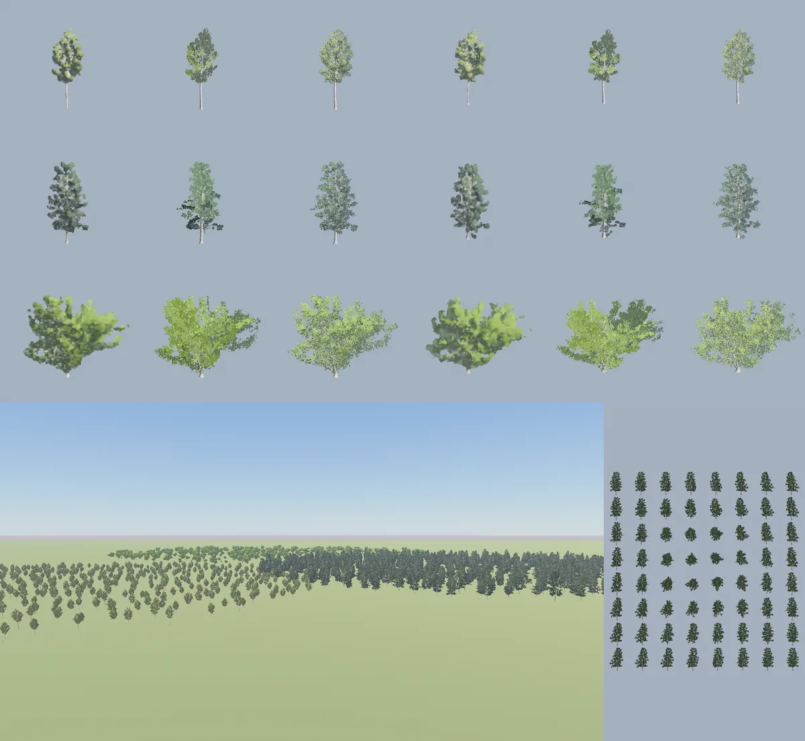
The quaking aspen, the black tupelo and the California black oak at twenty-eight of their heights
through a narrow lens, level and from a third of the way up the sky, each as its impostor, its cards
and its reduced level from the left, and below a forest of the three seen from a hill out to past a
kilometer beside the sixty-four frames of the tupelo's fourth variant.

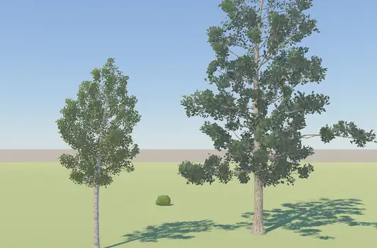
A quaking aspen and a black tupelo near and an oak behind them in a wind of 18 meters a second
blowing to the right, each trunk leaning downwind, its limbs swinging out of step and its leaves
fluttering, with their shadows swaying under them.

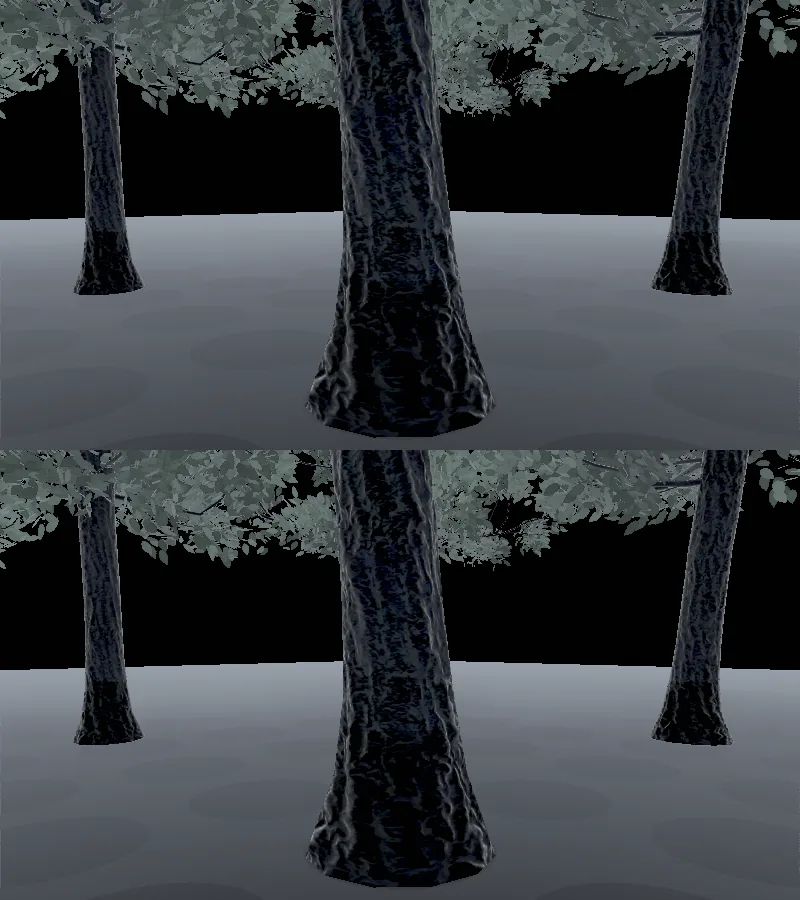
The floor under nine black tupelos at High under the sky's light alone, their leaves held solid in
global illumination's distance field above and letting half the light through a meter below, the
floor under the crowns lighter and its dark patches gone.

Item 70's leaves in the scene field, as cells that let a share of global illumination's light
through, as 3DEngine's item 100 gives its field. `MaterialSettings.LightThrough` is the share of the
light that passes a meter of a surface's depth. The bridge keeps it beside the material and writes
it in the fourth channel of each drawn mesh's color, the field's splat and stamp paint a cell's alpha
from 1 for a solid surface down to a half for one letting all through, and the resolve scales the
glow alike, so a reader dividing by the alpha takes the colors back. The probes' rays cross such a
surface, keeping the share for each meter of it and taking the rest from the surface, four such
surfaces at most, a crossing before a ray's interval kept for its probe's own faces alone. The screen
probes' rays cross them too, and the merge sees the probes above past them. A frame where nothing
drawn lets light through traces with a build that leaves the crossing out. A planted tree's leaves
let half through a meter, and the field paints the bark and the leaves their sets' mean colors. The
picture is the floor under nine black tupelos seven meters apart at High under the sky's light
alone, the leaves held solid in the field above and letting half through a meter below.

As `dotnet test BevyCSharp.Tests/BevyCSharp.Tests.csproj --filter
AFloorUnderASlabThatLetsLightThroughTakesTheSkyLightItsShareLetsThrough --logger
"console;verbosity=detailed"` prints it, a gray floor under a dark green slab a meter thick and
twenty across, read in linear light under the sky alone, the share of the sky's light a solid slab
holds back that the floor takes under a slab letting half through a meter, beside what the slab's
depth along each way the floor's sky comes from gives and what 3DEngine's engine reads of the same
scene.

| Slab | geometry | Low | High | 3DEngine, Low | 3DEngine, High |
|---|---|---|---|---|---|
| 2.5 m up | 0.36 | 0.44 | 0.32 | 0.36 | 0.40 |
| 5.5 m up | 0.41 | 0.24 | 0.24 | 0.37 | 0.32 |

The floor reads 0.0600 open, 0.0161 under a solid slab 2.5 m up and 0.0242 under one 5.5 m up, and
under a slab letting all through 0.0582 and 0.0569 at High, and 0.0564 at Low 5.5 m up, which holds
back a tenth of what a solid slab does where 3DEngine's holds back a hundredth.

`AForestFloorTakesTheSkyLightItsCanopyLetsThrough` prints the floor under the middle of the nine
tupelos at High under a bright sky alone, 0.2341 with no trees, 0.0375 under leaves held solid and
0.0797 under leaves letting half through a meter, 0.21 of what the solid canopy holds back, the same
in three runs, the floor's sky coming through the crowns along most of its ways.
`ACrownLetsAboutHalfTheLightThroughAMeter` prints the presets' crowns at 0.77 to 1.53 square meters
of leaf a cubic meter of the half meter cells their leaves lie in, letting 0.46 to 0.68 of the light
through a meter by Beer and Lambert's law.

Two faults were found on the way. The field read a drawn mesh's material only where it was the
standard material, so since the leaf material and the wind's bark material came, a tree stood in the
field white and closed. It reads the leaves' and the bark's materials through the standard material
they are built over, and leaves the impostor out. And the field took every visible mesh, where a
visibility range hides a mesh from each view and not from what it inherits, so a planted tree stood
in it as its full, reduced and far levels at once; it takes a mesh with a range where the eye the
field lies around stands within it.

Item 70's impostor, a planted tree past twenty of its heights drawn as one quad turned to the eye
and painted from three of sixty-four pictures of the whole tree. Each variant is pictured once an
app from eight by eight ways laid on a square folded over the upper half of the sphere, the square's
edge level with the ground, its full stems and leaves stood in a grid of frames under the world on
the cards' render layer, each copy turned so an orthographic camera sees it from its frame's way,
drawn unlit at twice the 512 texel atlas and halved, with the frames' leaves kept in the smaller
levels as the cards keep theirs. Two normal atlases go beside it, drawn on the CPU from the same
triangles, the normal a leaf's diffuse light is lit by, bent half way out of the crown as the leaf
material bends it, and the leaf's own normal turned to the frame's eye. The quad stands at the
middle of the tree's sphere square to the eye, and square to the light in the light's shadow. Each
pixel finds where its ray meets the planes of the three frames pictured nearest the way the tree is
seen from, the corners of the triangle of the folded square's grid that way falls in, blends them by
their nearness and their opacity, and lights the blend twice as the leaf material lights a leaf,
with the leaf set's mean surface. The impostor casts its shadow and takes none, since its own, cast
by a quad square to the light through the tree's middle, would darken whichever half of it stands
behind that quad. The picture holds each tree at twenty-eight of its heights through a narrow lens,
level and from a third of the way up the sky, as its impostor, its cards and its reduced level from
the left, and below a forest of the three species seen from a hill out to past a kilometer, beside
the sixty-four frames of the black tupelo's fourth variant.

As `dotnet test BevyCSharp.Tests/BevyCSharp.Tests.csproj --filter
AFarTreesImpostorCoversItsCrownAsItsCardsDo --logger "console;verbosity=detailed"` prints them, each
tree at twenty-eight of its heights in the sun under a pale sky, its impostor against its limbs and
cards drawn in its place.

| Tree | View | Impostor, pixels | Cards, pixels | Impostor, brightness | Cards, brightness |
|---|---|---|---|---|---|
| quaking aspen | level | 3075 | 2805 | 135 | 129 |
| quaking aspen | from above | 2886 | 2680 | 140 | 130 |
| black tupelo | level | 4848 | 4186 | 115 | 128 |
| black tupelo | from above | 4651 | 4026 | 122 | 128 |
| California black oak | level | 12131 | 11312 | 129 | 145 |
| California black oak | from above | 11594 | 10906 | 138 | 148 |

The impostor covers the crown at 1.06 to 1.16 of the cards and is as bright within an eighth. Seen
through the narrow lens it is softer than the cards, each frame drawn several times larger than it
was pictured, where past twenty of its heights in a 45 degree picture 1080 pixels high a tree stands
about as tall as its frame holds it.

One fault was found on the way. Lit fully rough at the cards' reflectance, the tupelo's and the
oak's impostors were 100 and 120 against their cards' 128 and 145 by the same command, and darker
than the reduced level with the sun put out, under the sky's light alone, which no turn of a normal
toward the sun changes. The light lost was the sky's sheen the leaves' own gloss gives them where
they are seen at a slant, and the leaf set's mean roughness and metallic mend it. A third atlas of
the leaves' own normals, lighting the light let through and the specular as the leaf material does
in place of the way to the eye, moved the tupelo from 102 to 100 and the oak from 117 to 120 by the
same command, and is kept as the leaf material's own lighting.

`AWayIsBlendedFromTheThreeFramesPicturedNearestIt` prints a way standing at most 22.6 degrees from
the frame it takes most from, the widest cells of the grid lying near the zenith, where the fold
stretches the square most. `AnImpostorsFramesHoldTheWholeTreeFromEveryWay` prints each preset's
sphere, the oak's 15.1 meters across its half in a frame 32.2 meters a side.

The cost, as `TheImpostorsCostIsReadInAFarForest` prints it on the RTX 4070 Laptop GPU, a thousand
black tupelos planted on a disc thirty-eight of their heights off, the nearest some 836 meters away,
at 1920 by 1080, the opaque pass 0.90 and 1.00 ms in two runs with the trees as limbs and cards and
0.55 and 0.49 ms as impostors, and the shadow pass 0.05 ms either way, the sun's shadow reaching no
tree so far off.

Item 70's wind, a planted tree swaying in the wind in three movements, as SpeedTree's and Pivot
Painter's wind moves a tree by the pivots its vertices carry. Its trunk bends downwind by the square
of a point's height, each limb swings about where it leaves its parent by the square of a point's
reach from there, and each leaf flutters about its stalk across its reach, each limb and leaf in a
phase of its own and each tree in one from where it stands. Each vertex of the stems and leaves
carries two streams of the game's own at locations 8 and 9, the pivot and phase of the limb it
swings with and the pivot and phase its leaf flutters about. The limbs are the tree's sixteen
thickest stems, the ones its far cards gather its foliage by, and each thinner stem growing from the
trunk below them swings as a limb of its own. The bark takes a material extension of its own and
the leaf material gains the same vertex stages, Bevy's mesh vertex stage and prepass vertex stage
written again with the sway, which their specialize hands the two streams after the attributes
Bevy's pipeline gave them, so the shadows sway with the trees. The far cards swing with their limbs
and the impostor leans with its trunk. The wind is the weather's of the first camera given one, or
the one `Trees.Wind` sets, written into every tree material on the frames it changes, with the frame
before's for the motion vectors. A gale bends a tree's top by about a fiftieth of its height. The
picture is a quaking aspen and a black tupelo near and an oak behind them in a wind of 18 meters a
second blowing to the right, thirty-two frames.

As `dotnet test BevyCSharp.Tests/BevyCSharp.Tests.csproj --filter
EachVertexOfATreeCarriesThePivotOfTheLimbItSwingsWith --logger "console;verbosity=detailed"` prints
them, the stems' vertices swinging with a limb and the limbs among the leaves.

| Tree | Stem vertices swinging | Stem vertices | Limbs among the leaves | Leaves |
|---|---|---|---|---|
| quaking aspen | 22716 | 24948 | 204 | 22500 |
| black tupelo | 22482 | 24762 | 292 | 29999 |
| California black oak | 104220 | 106404 | 467 | 30000 |

`AWindBendsATreeDownwindAndTwoTreesAlikeSwayOutOfStep` prints two aspens of one seed, so of one
variant, turn and size, ten meters apart and seen from 25 meters, their crowns' middles 3.85 to 4.96
pixels downwind of where they stood in still air in a wind of 20 meters a second, over six moments,
the two apart by up to 0.51 pixels, and in still air the picture the same from frame to frame.

The cost, as `TheWindsCostIsReadInAForest` prints it on the RTX 4070 Laptop GPU, 24 planted tupelos
drawn whole at 1920 by 1080, the shadow pass 3.39 ms in still air and 3.38 ms in a wind of 15 meters
a second, and the opaque pass 6.30 and 6.24 ms, the sway's cost within a run's own spread.

One thing was found on the way. Bevy's prepass draws with a view bind group of its own, which holds
the frame's globals, the time among them, at binding 1 where the main pass's holds them at 11, and
Bevy's own prepass shaders read none, so the trees' and the impostor's prepass vertex stages declare
them there.

Item 77, what the trees hold, read by species, variant and part, and what a forest of a thousand
trees of three species and the suite hold and leave behind, then cut as the reading showed.

As `dotnet test BevyCSharp.Tests/BevyCSharp.Tests.csproj --filter
AVariantKeepsItsSkeletonAndCapsulesAloneForTheProcess --logger "console;verbosity=detailed"` prints
it, a species' eight variants, their arrays' bytes in megabytes, the skeleton and the capsules the
process keeps, and the rest, which each app that draws a variant shapes from the skeleton. The two
cards of a branch share their stems and leaves, counted once.

| Species | kept | drawn from | stems, full | stems, reduced | leaves, full | leaves, reduced | far limbs and quads | cards' stems | cards' leaves |
|---|---|---|---|---|---|---|---|---|---|
| quaking-aspen | 0.17 | 156.3 | 12.6 | 4.5 | 64.5 | 32.3 | 1.7 | 3.6 | 37.1 |
| black-tupelo | 0.20 | 202.4 | 13.5 | 4.2 | 86.1 | 43.0 | 1.6 | 4.6 | 49.4 |
| weeping-willow | 0.88 | 270.5 | 54.6 | 10.9 | 86.1 | 43.0 | 3.3 | 23.2 | 49.4 |
| california-black-oak | 0.89 | 261.4 | 49.5 | 8.4 | 86.1 | 43.0 | 3.6 | 21.4 | 49.4 |
| bush | 0.47 | 125.6 | 34.4 | 18.2 | 28.9 | 14.5 | 3.4 | 9.6 | 16.6 |
| fern | 0.06 | 11.1 | 6.9 | 3.4 | 0.5 | 0.5 | | | |

Before the cuts the process kept all of it, 1,027 MB for the forty-eight variants the suite plants,
for as long as it ran. The same test prints what shaping a species' first variant allocates beside
what it keeps, 63 MB for an aspen's 19.5, 73 for a tupelo's 25.2, 152 for a willow's 35.6, 128 for
an oak's 32.6, 74 for a bush's 15.6 and 7 for a fern's 1.3, three to five times. The pictures'
staging is the cards' stems and leaves stood under the world and the captures, the cards' 512 texels
a side of four bytes and the impostor's 1024, a megabyte and four, and the atlases' levels read back
come to 2.8 MB of the cards' colors and normals and 4.2 MB of the impostor's colors, normals and
faces a variant, which the app's record of the variant held as bytes after the images were made from
them.

As `dotnet test BevyCSharp.Tests/BevyCSharp.Tests.csproj --filter
AThousandTreeForestOfThreeSpeciesHoldsItsMeshesAndAtlasesAlone --logger
"console;verbosity=detailed"` prints it, run alone in a 20 GB scope, a thousand trees of three
species, aspens, tupelos and oaks on three discs, drawn at 640 by 360 on an RTX 4070 Laptop GPU and
read once they are all dressed, after a compacting collection, and again once its app and one after
it have run. The same test read the forest before the cuts, and with the cuts and every variant
shaped at once.

| | before the cuts | shaped at once | four at a time |
|---|---|---|---|
| managed memory live, dressed | 1,317 MB | 21.7 MB | 21.4 MB |
| the variants, kept for the process | 621.3 MB | 1.26 MB | 1.26 MB |
| the variants' shapes and pictures, held by the app | | 0 | 0 |
| the process, anonymous resident, dressed | 5.52 GB | 4.92 GB | 2.13 GB |
| its peak | 5.62 GB | 4.99 GB | 2.19 GB |
| the bridge's allocations | 871 MB | 863 MB | 846 MB |
| the GPU's allocations | 1.62 GB | 1.65 GB | 1.08 GB |
| managed memory live after, 19.2 MB before | | | 21.2 MB |
| the test | 28 s | 30 s | 56 s |

Before the cuts the variants held 621 MB of the live memory, the copies `Render.CreateMesh` keeps of
data for a scene to write down held 477 MB, and the app's record of each variant held its atlases'
levels. With the first two cut and the last let go, what the process holds of a dressed forest is
the bridge's meshes and atlases, the GPU driver's own memory and the garbage the collector has not
yet taken back, which took the process to 4.99 GB at its peak with every variant shaped at once.
Before the cuts the variants' 621 MB stayed for as long as the process ran. Once the forest's app
and one more have run, the process holds 2.0 MB more than before, the twenty-four variants'
skeletons and capsules among it. The engine holds the last app it ran through statics such as
SceneField's until the next app replaces them, and lets the ones before it go.

Three cuts. The process keeps a variant's skeleton and capsules alone, and an app that draws the
variant shapes its meshes' data and plans its far levels from the skeleton on a worker and lets go
of both, the plans' per-card stems and leaves among them, once its meshes are made and its far
levels pictured, the atlases' bytes with them. The trees' meshes are made without the copy
`Render.CreateMesh` keeps of data for a scene to write down, since a scene writes a tree as its
species and seed. And an app shapes and pictures four variants at a time, since shaping allocates
several times what it keeps in arrays the collector takes back in its full collections alone.

The suite, run whole through `build/test.py suite --no-build --timeout-minutes 100` in a 20 GB scope
with `BCS_MEMORY_CAP_GB=3`, passed 1,976 tests and skipped 3 in one host in 42 minutes, the
listing's 1,968 and eleven rows its theories add, and no stop at the cap. The host's anonymous
resident memory, `RssAnon` of its `/proc` status read each second by a loop beside the run, was
2,222 MB at most, as the canopy's tests ran, and the script read the host's whole resident set at
2,803 MB at most. Before the cuts the host passed the 3.75 GB cap the scope gave it after 469 tests,
in a different tree test each of three runs.

Done that day

- Item 70 at `929a1cf7`. Trees and foliage grow from a seed inside Weber and Penn's parameters,
  through the modeling, with no asset files.
- Item 77 at `bc5559d2`. The trees' memory for the process read and cut, and the memory guard's stop
  read as a stop.

## 2026-10-25

The feature test looking west at 12:00, 17:00, 17:36, 18:24 and 21:00, the sun at 45, 11, 4, minus 4
and minus 30 degrees, under the vivid look above and the day's cycle on it below, the two alike at
noon, the cycle warmer and deeper toward sunset, bluer through the twilight and a calmer navy at
night.

The weather crate's sky at its High tier before item 69 replaces it, few clouds, partly cloudy,
overcast, storm and fog left to right, at noon above and near sunset below, the references the
engine's own fog and clouds are read against.

A colonnade between the camera and a sun 8 degrees up in fog seen to 95% at 160 meters, the fog in
closed form, in froxels at High and in Bevy's own volumetric fog above, and by night under three
lamps in closed form and in froxels below, the lamps glowing in the froxels, with the middle of the
day pair beside them, where the pillar standing between the eye and the sun casts its shadow down
the whole way and the fog there takes the sky's blue alone.

The feature test's render gallery at 17:36 with the fog in closed form on the left and in froxels at
Medium on the right, the fog in the gallery wall's shadow before it lit by the sky alone and bluer.

The engine's clouds at coverages of 0.15, 0.3, 0.5, 0.7 and 0.9, at noon above and with the sun four
degrees up below, from a clear sky through fair weather heaps to a broken sky.

The weather crate's few clouds, partly cloudy, overcast and storm at its High tier in the first and
third rows, at noon and near sunset, and the engine's clouds at High under the same sky at coverages
of 0.3, 0.5, 0.75 and 1 below each, rounded heaps with worn edges, white by day and lit gold from
below at sunset where the crate's are small and gray and its overcast a flat deck.

The feature test's hub at 14:00 and 17:36 under no cloud on the left and the engine's clouds at a
cover of 0.4 on the right, white heaps by day and at sunset dark with gold lit tops and a bright
edge on the one before the sun.

The ground seen from 300 meters up under the weather crate's partly cloudy sky and its cookie built
on the CPU on the left, and under the engine's clouds at a coverage of 0.5 and their shadow built on
the GPU on the right, the shade under a cloud lit by the sky alone and blue, soft at its edges and
drifting with the clouds.

The feature test's hub from 90 meters up at 14:00 under no cloud on the left and in a cloud's shadow
at a cover of 0.5 on the right, the ground and the froxels' fog over it lit by the sky alone.

The weather crate's clear sky at midnight on the left, and the engine's night sky by its sky clock
at midnight and at 20:30, under Bevy's atmosphere lit by a gibbous moon, the stars fine and few
bright, the galaxy's band crossing the sky with its dark lanes, and the moon a small disc lit from
the sun's way.

The feature test's sky by the clock at 19:12 looking east as the full moon rises and at 03:00
looking west as it sets, with the clouds lit by the brightest light before the change on the left,
the sun set behind the planet leaving them black, and by the brightest light through the air after
it on the right, moonlit gray and warm toward the low moon.

The weather crate's few clouds, partly cloudy, overcast, storm and fog presets at noon in the first
row and in the evening in the third, against the engine's weather on the same presets in the second
and fourth, its heaps rounded, its overcast and storm a flat deck, its fog a broken deck over a
misty distance, and the ground under the decks lit blue by Bevy's sky light, which does not see the
clouds.

The feature test's hub at 15:00 under the engine's weather, partly cloudy, overcast and rain in the
top row and storm, fog and snow below, each taken at once with sky.weather, the decks a darker gray
as the weather worsens and the fog's deck thinning to a soft broken edge.

Rain at 0.8 in a test scene under a clear afternoon sky and lit by a lamp at dusk above, and below,
the Rain weather's storm seen from under a roof, the air beneath it clear and the rain blowing past
its edges, and the Snow weather's flakes, all drawn after temporal antialiasing.

The feature test's meadow at 15:00 under the engine's Rain, Storm and Snow weathers taken in that
order, the storm's streaks drawn toward where its wind blows and the snow falling at once where the
rain had been, and the hub in rain at 21:30 with the drops faint in the dark, the ground under the
decks lit blue by Bevy's sky light, which does not see the clouds.

The feature test's meadow under its Thunderstorm weather at 22:00 before a strike and three frames
after one 650 meters off, the bolt standing over the trees, and at 16:00 with a strike 600 meters
off, its foot behind a tree.

A test scene under the Thunderstorm weather at night above and by day below, before a strike 900
meters off, three frames into its flash with the clouds glowing about it, the rain lit and the bolt
drawn from the clouds' base to the ground, and twelve frames in as the glow dies and the bolt
flickers on, its foot behind the nearer block.

The feature test's hub at 15:00 under its Overcast, Rain and Snow weathers, above with the sky
lighting filtered from the clear sky, the ground lit blue-teal under the decks, and below with the
clouds laid over the sky the lighting is filtered from, the ground gray and the flakes white.

A tree grown by seed 2 from controls near the paper's quaking aspen, bare of leaves under an
afternoon sun, its trunk bare to four tenths of its height and its branches turning up into a narrow
crown, and below, seeds 1, 2 and 3 of the same species standing side by side.

The quaking aspen of seed 5 grown in the open on the left and a meter from a wall on the right,
where the wall takes the sky from the crown's side next to it and the tree stands away from it,
trunk and crown.

The library's six species grown bare by seed 2 under the shadow grid, each framed to its own size,
above the quaking aspen, the black tupelo and the weeping willow of the paper's appendix, and below
its California black oak, the bush and the fern.

The collection's first sets drawn through Bevy's loader from their BC7 and BC5 files, above each
bark on its preset's trunk, the quaking aspen's silver birch, the black tupelo's broadleaf, the
weeping willow's own, the oak's broadleaf and the bush's hornbeam, and below the six leaf atlases on
cards cut out by their opacity, the silver birch, the alder, the willow, the shingle oak, the
hornbeam and the fern.

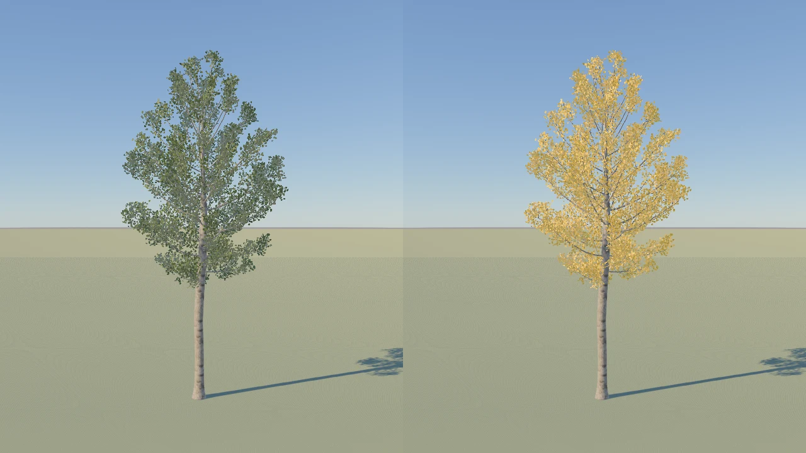
The quaking aspen of seed 2 in summer on the left and with its leaves turned all the way to its fall
color on the right, the silver birch leaves' mean green tinted to gold.

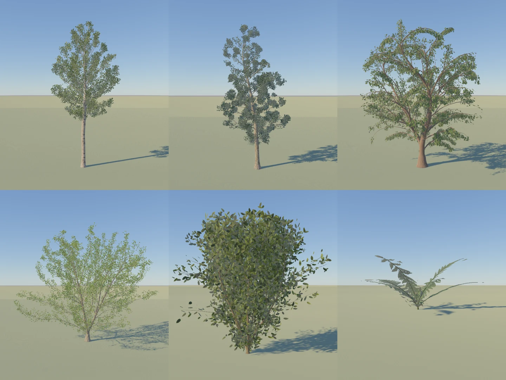
The library's six species in leaf by seed 2, their bark and leaves from the texture collection,
above the quaking aspen, the black tupelo and the weeping willow, below the California black oak,
the bush and the fern, whose fronds are strips along their stems.

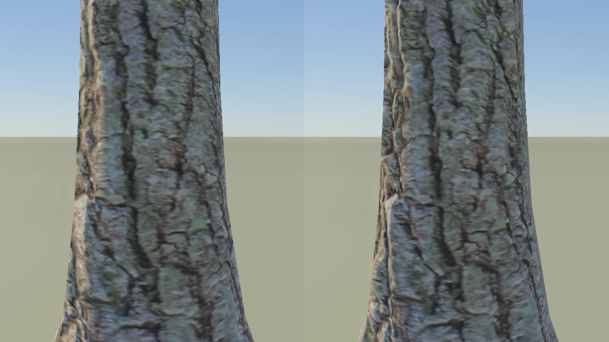
The black tupelo's trunk at reading distance with the sun grazing it from the left, its broadleaf
bark flat on the left and with depth by parallax occlusion on the right, where the ridges stand out
and hide the grooves behind them toward the trunk's edge while its outline stays round.

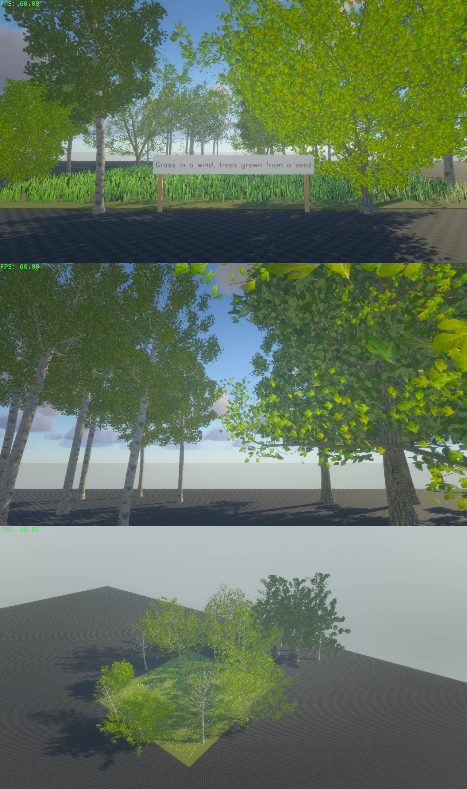
The feature test's meadow from the road with its ring of grown aspens and oaks, the forest of aspens
and tupelos behind it from inside, and the whole from above, where the nearest aspen's leaves thin
out at that distance.

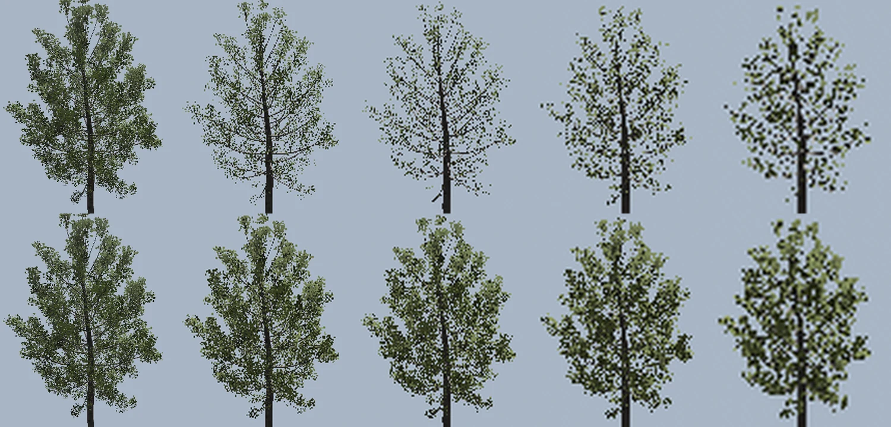
A lone quaking aspen against the sky from 37 degrees above at 15, 25, 35, 50 and 70 meters, its
crown drawn the same size, thinning to bare twigs with the leaf atlas's levels as they were imported
above and keeping its leaves with each leaf's sampled share kept below.

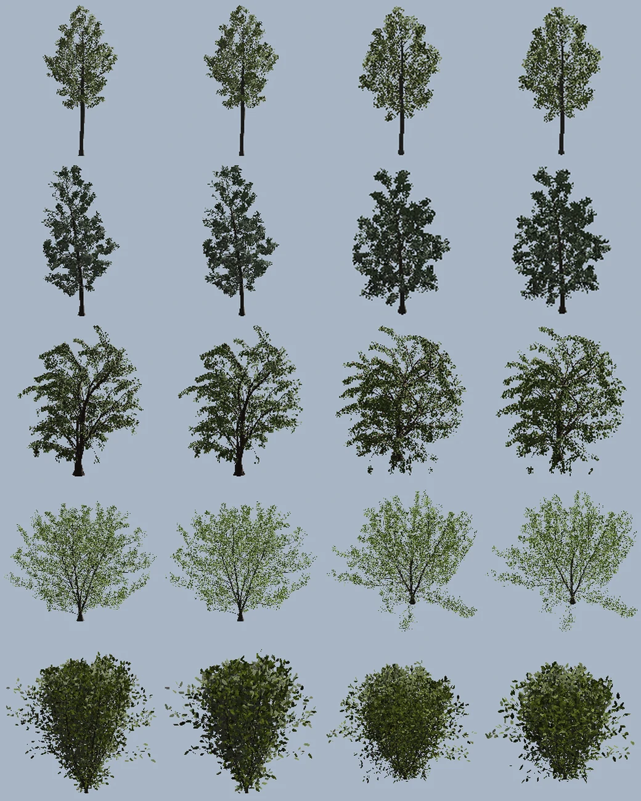
The quaking aspen, the black tupelo, the weeping willow, the California black oak and the bush, a
row each, at two and a half of their heights where a planted tree changes level, each from the side
and from 37 degrees above in its full level and then its reduced one of half the sides, the thinnest
stems left out and every other leaf drawn larger.

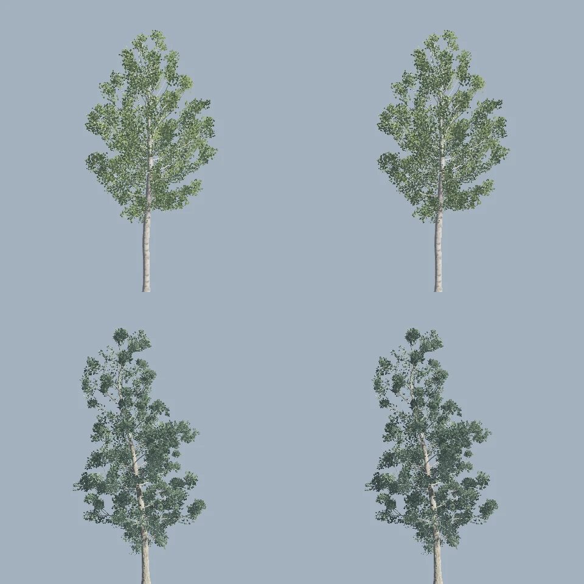
The quaking aspen above and the black tupelo below in the sun under a pale sky, each drawn without
the gray of the sky its leaves see on the left and with it on the right, the leaves deep in each
crown a little darker.

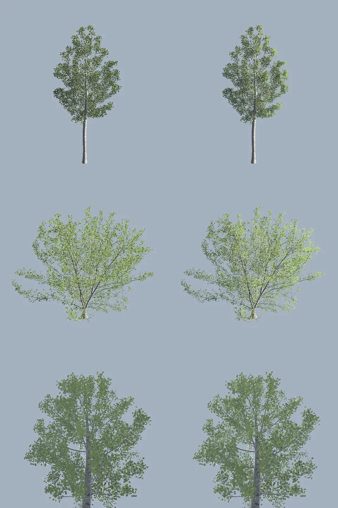
The quaking aspen and the California black oak in a grazing sun from the right and the aspen from
below under a high sun, each lit by its leaves' own normals on the left and with its diffuse light
by normals bent out of the crown on the right, the sun's side of each crown standing out and the
crown from below keeping its green.

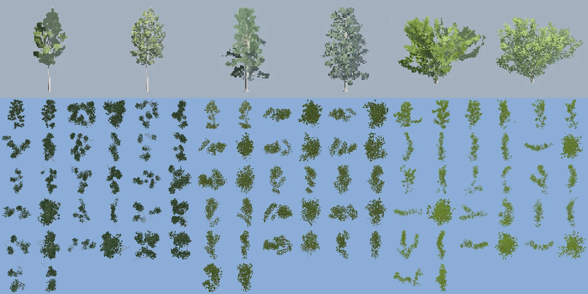
The quaking aspen, the black tupelo and the California black oak at eight of their heights, each
drawn in its far level of limbs and crossed cards on the left and its reduced level on the right,
and below each the atlas its fourth variant's cards are pictured into.

The leaves thinning with distance, which the forest's reading left open, come from the leaf atlases'
smaller levels. The import scaled each level's opacity so the share of the atlas's texels past one
half stayed the top level's, which holds while a leaf's box is several texels across. At the level
where a silver birch leaf's box is a texel or two across, the whole atlas of twelve leaves sixteen
and eight texels wide, its texels are averaged with the transparent ones round it, and a card
sampling the box falls under the cut while the share of the whole atlas still holds. The import
scales each level so the share of each leaf's box past one half, read between the level's texels
as a card samples it, stays the top level's on average, and the six leaf sets were imported again,
their albedos alone changing.

Each preset alone against the sky, from 37 degrees above and from the side, at a distance holding
its crown in the picture and at twice and four times it, its leaves' pixels times the distance
squared against the nearest's, as `dotnet test BevyCSharp.Tests/BevyCSharp.Tests.csproj --filter
ACrownKeepsItsLeavesWithDistance --logger "console;verbosity=detailed"` prints them, with the
atlases `d151e0cc` imported and with these.

| Set | From | Nearest | Twice, before | Four times, before | Twice | Four times |
|---|---|---|---|---|---|---|
| silver-birch-leaves | above | 18.8 m | 0.21 | 0.34 | 0.96 | 0.97 |
| silver-birch-leaves | the side | 18.8 m | 0.27 | 0.39 | 1.03 | 1.01 |
| red-alder-leaves | above | 40.4 m | 0.88 | 0.69 | 0.97 | 1.34 |
| red-alder-leaves | the side | 40.4 m | 1.02 | 0.59 | 0.99 | 1.46 |
| weeping-willow-leaves | above | 25.2 m | 0.62 | 0.78 | 1.01 | 1.01 |
| weeping-willow-leaves | the side | 25.2 m | 0.63 | 0.82 | 1.02 | 1.01 |
| shingle-oak-leaves | above | 37.7 m | 1.41 | 1.43 | 1.49 | 1.51 |
| shingle-oak-leaves | the side | 37.7 m | 1.38 | 1.39 | 1.45 | 1.46 |
| hornbeam-leaves | above | 3.4 m | 0.92 | 0.82 | 0.98 | 0.97 |
| hornbeam-leaves | the side | 3.4 m | 0.96 | 0.96 | 1.02 | 1.07 |
| fern-leaves | above | 3.3 m | 0.91 | 0.89 | 0.93 | 0.95 |
| fern-leaves | the side | 3.3 m | 1.01 | 0.95 | 1.05 | 1.06 |

The test asks each to hold three quarters of the nearest's, which the silver birch, the alder and
the willow failed before. Where a crown covers more far off, the oak's from twice its distance and
the alder's at four times, its leaves are under a texel of the level drawn, whose opacity is all
or nothing round them, and a far crown's cards are item 70's next part. The pictures are the
variant the forest's nearest aspen grows as, alone from above at 15, 25, 35, 50 and 70 meters, its
crown drawn the same size, before and after. In the feature test the nearest aspen of the ring,
seen from above at 35 and 60 meters, keeps its leaves where it stood bare.

Item 70's far level, a planted tree past six of its heights drawn as its sixteen thickest stems,
with a third of their sides, and the branches and leaves each one carries through thinner stems on
two crossed cards. A card's plane is the one its leaves spread most in, upright, facing out of the
crown, and the second card is turned a quarter round its upright from the first, since one card
alone thins to a line seen along it. Each variant's cards are pictured once an app, the stems and
leaves of each card stood in a cell of a grid under the world on a render layer of their own, turned
to face an orthographic camera and scaled to fill the cell, drawn unlit into a 512 texel atlas,
read back, and given their smaller levels with each card's leaves kept as the leaf sets' levels
keep theirs. A normal map of the leaves each card pictures, drawn on the CPU from the same cards and
stems in the card's frame, goes beside it, and the cards are lit by the leaf material with the leaf
set's mean translucency and occlusion, which the import records, fully rough, since a texel of a
card stands for many leaves turned every way. The picture holds each tree's far level on the left
of its reduced level at eight of its heights, and below each tree's atlas of the fourth variant.

As `dotnet test BevyCSharp.Tests/BevyCSharp.Tests.csproj --filter
AFarTreeOfCardsCoversItsCrownAsTheReducedOneDoes --logger "console;verbosity=detailed"` prints
them, each tree at eight of its heights in the sun under a pale sky, the far level against the
reduced level built by hand at the same place, turn and size.

| Tree | Far level, pixels | Reduced, pixels | Far level, brightness | Reduced, brightness |
|---|---|---|---|---|
| quaking aspen | 735 | 774 | 113 | 135 |
| black tupelo | 1115 | 1372 | 127 | 125 |
| California black oak | 3020 | 3036 | 124 | 139 |

The cards cover the crown within a fifth and are as bright within a sixth, a little darker where
the leaves' own turning lights them less than a card's average does. Three faults were found on the
way. A single card a branch covered the aspen's crown at 0.6 of the reduced level and thinned the
tupelo's, which the crossed card mends. The flat pictures lit by the cards' own face were up to half
again as bright as the leaves, which the normal map and the set's surface mend. And the camera's
picture is read back sRGB, which read as linear made every card brighter still.

The cost, as `TheFarLevelsCostIsReadInADistantForest` prints it on the RTX 4070 Laptop GPU, 48 black
tupelos planted on a disc 160 meters off at 1920 by 1080, the shadow pass 0.97 ms with the trees in
their reduced level and 0.42 ms in their far one, the opaque pass 3.20 and 2.95 ms, the far cards'
overdraw lit twice as the leaves are.

The feature test's meadow planted with `Trees.Plant` and `Trees.PlantForest`, a ring of ten aspens
and oaks round it, two bushes and a fern in it, and a forest of six tupelos and nine aspens behind
it, 28 trees in all, which grow eight variants of each species once and share their meshes. The
sphere crowns it stood with before are the other side of the table.

Each view was read in `./bcs open --feature-test --offscreen --frames 0 --frame-time 0.0166667
--hold loads,commands --timings`, the camera set by `./bcs command look`, 120 frames waited, and the
passes read with `./bcs command render.timings`, on the RTX 4070 Laptop GPU at 1280 by 720. The
meadow is seen from the road at `look 0 1.2 46 0 4 80`, the forest from inside at `look 0 1.6 90 0
7 110`, and the whole from above at `look -40 38 38 0 0 92`.

| View | Shadows, spheres | Shadows, trees | Prepass, spheres | Prepass, trees | Opaque, spheres | Opaque, trees |
|---|---|---|---|---|---|---|
| meadow | 0.142 ms | 3.276 ms | 0.030 ms | 0.607 ms | 0.029 ms | 0.441 ms |
| forest | 0.116 ms | 3.026 ms | 0.002 ms | 0.369 ms | 0.027 ms | 0.673 ms |
| above | 0.113 ms | 1.594 ms | 0.023 ms | 0.549 ms | 0.036 ms | 0.476 ms |

The trees cost the most in the sun's shadow cascades, which draw every card of every crown near the
camera whichever way it looks, and less in the prepass and the opaque pass, which see only what is
in view. The whole frame's GPU time, 12.6, 16.2 and 12.6 ms with the spheres and 12.6, 12.0 and
10.4 ms with the trees as `./bcs command frame.profile` gives it, swings more between runs than the
trees add to it, so the passes are what is read here. The fewer cards and sides of item 70's next
part are for the shadow pass first.

One aspen of the ring stood bare in the first pictures, its leaves drawn once anything moved them.
The tree's own entity, the parent of its meshes, had no `Visibility`, which Bevy warns of as B0004
for every tree in the session's log, and dressing a tree gives it one.

Seen from 37 degrees above, the nearest aspen's leaves are whole at 15 meters, thin at 25 and gone
from 35, with `./bcs command look` set at points 15, 25, 35, 46, 60 and 80 meters from its crown
along that line and `./bcs shot` taken at each, while the crowns' shadows on the grass, seen from
straight above at 60 meters, stay whole. Why the leaves thin there is not settled here, and the far
crowns of item 70's next part take it up.

Six trees grown from controls near the paper's quaking aspen, its leaves left out, by seeds 1 to 6,
as `dotnet test BevyCSharp.Tests/BevyCSharp.Tests.csproj --filter AnAspenKeepsWithinItsTriangles
--logger "console;verbosity=detailed"` prints them. The height is the species' 13 meters with three
either way, the spread is the farthest point from the trunk's axis, the trunk's radius is at the
ground, and the triangles are those of the bare stems, from twelve sides on the trunk down to three
on the thinnest twigs.

| Seed | Points | Tips | Height | Spread | Trunk's radius | Triangles |
|---|---|---|---|---|---|---|
| 1 | 1165 | 323 | 12.1 m | 2.6 m | 18.0 cm | 12976 |
| 2 | 1142 | 332 | 15.3 m | 3.9 m | 22.3 cm | 12824 |
| 3 | 1153 | 341 | 14.8 m | 3.2 m | 21.4 cm | 12922 |
| 4 | 1144 | 337 | 10.4 m | 2.3 m | 15.2 cm | 12818 |
| 5 | 1108 | 309 | 10.6 m | 2.4 m | 15.7 cm | 12472 |
| 6 | 1046 | 305 | 13.1 m | 3.0 m | 19.4 cm | 11868 |

The six presets in leaf by seed 2, as `dotnet test BevyCSharp.Tests/BevyCSharp.Tests.csproj --filter
EveryPresetsLeavesKeepToTheirBound --logger "console;verbosity=detailed"` prints them. The paper's
leaves on each twig are the species' own, the twigs are the stems the grown tree carries no other
on, and the cards are its leaves, a frond strip each for the fern.

| Preset | Leaves on each twig, the paper's | Twigs | Cards | Triangles of the cards | Triangles of the stems |
|---|---|---|---|---|---|
| quaking aspen | 25 | 298 | 22500 | 45000 | 12482 |
| black tupelo | 6 | 467 | 29999 | 59998 | 12106 |
| weeping willow | 15 | 2880 | 29999 | 59998 | 46466 |
| California black oak | 25 | 2110 | 30000 | 60000 | 51236 |
| bush | 12 | 407 | 10080 | 20160 | 32350 |
| fern | -1 | 13 | 13 | 560 | 4952 |

The aspen carries the paper's 22,500 leaves, its 25 on each of the 900 twigs its levels make,
shared among the 298 it grew. The tupelo, the willow and the oak reach the bound of 30,000, their
leaves drawn larger by the root of the paper's count over it, 1.04 times for the tupelo's 32,400
and the most, 1.6, for the willow's 1,215,000 and the oak's 216,000, their three trunks each counted.

Held against the paper's plates in leaf, the aspen's crown is the narrow oval of plate 1 (q) over
its bare trunk, the tupelo's a crown on a central leader as plate 2 (a)'s, more open than the
paper's dense one, the willow's an umbrella of arching limbs with its leaves hanging along them,
shorter than plate 5's curtains, which the pruning envelope cuts, and the oak's a broad rounded
crown as plate 1 (a)'s, lighter in color for its shingle oak leaves.

A planted tree is drawn in two levels of detail, its full level within two and a half of its
heights of the camera and its reduced level past three, Bevy's visibility range dithering one into
the other between. The reduced level has half the tube sides, leaves out the stems thinner where
they start than a twenty-fifth of the trunk, and draws every other leaf of the full level the
square root of two larger about its stalk. Its stems, as `dotnet test
BevyCSharp.Tests/BevyCSharp.Tests.csproj --filter AReducedTreeKeepsItsTrunkAndLimbsInFewerTriangles
--logger "console;verbosity=detailed"` prints them, are 4,408 triangles of the aspen's 12,482, 3,564
of the tupelo's 12,106 and 8,948 of the oak's 51,236, and its leaves half the cards.

Each tree alone against the sky at two and a half of its heights, from the side and from 37
degrees above, as `AReducedTreeCoversItsCrownAsTheFullOneDoesWhereTheyChange` prints them, the
pixels of leaf and the rest of the tree, whole and reduced.

| Tree | From | Leaves, whole | Leaves, reduced | The rest, whole | The rest, reduced |
|---|---|---|---|---|---|
| quaking aspen | the side | 3749 | 4057 | 977 | 801 |
| quaking aspen | above | 3414 | 3712 | 850 | 700 |
| black tupelo | the side | 2972 | 3324 | 3238 | 3085 |
| black tupelo | above | 2961 | 3289 | 2389 | 2183 |
| weeping willow | the side | 7178 | 7537 | 2923 | 2289 |
| weeping willow | above | 7782 | 8183 | 2344 | 1711 |
| California black oak | the side | 9886 | 10250 | 2542 | 1522 |
| California black oak | above | 9002 | 9145 | 2160 | 1314 |
| bush | the side | 12818 | 12566 | 2851 | 3380 |
| bush | above | 13429 | 13411 | 1612 | 1852 |

The reduced level's larger cards cover a little more, up to an eighth for the tupelo, and the twigs
it leaves out, which showed between the leaves as lines a pixel wide, cover less, the whole tree
within a tenth. The picture holds each pair, whole on the left and reduced on the right, from the
side and from above.

With the levels the trees near the camera in the feature test cast no shadow. Bevy 0.20 measures a
directional light's cascades from the camera they belong to by looking that camera up among the
render world's views by its main world entity, which finds nothing, and falls back to its shadow
origin, the entity carrying `ShadowLodOrigin`, else the first camera drawing to a window, else the
first camera of all. Offscreen that was a light probe's face camera, so a near tree's full level was
dithered out of the shadow by the probe's distance while its reduced level was left out of the
casters as too near the scene's camera. The bridge gives each 3D camera drawing the game's picture
`ShadowLodOrigin`, giving way to one the game gives itself, and the shadows came back.

The feature test's three views of the forest's reading, each read twice with the levels and twice
with every tree held at its full level by a build whose switching distance was out of reach, in
`./bcs open --feature-test --offscreen --frames 0 --frame-time 0.0166667 --hold loads,commands
--timings` with the camera set by `./bcs command look`, 120 frames waited and the passes read with
`./bcs command render.timings`, on the RTX 4070 Laptop GPU at 1280 by 720.

| View | Shadows, full | Shadows, levels | Prepass, full | Prepass, levels | Opaque, full | Opaque, levels |
|---|---|---|---|---|---|---|
| meadow | 2.31 to 2.76 ms | 3.02 to 3.49 ms | 0.60 to 0.61 ms | 0.97 to 1.50 ms | 0.43 to 0.44 ms | 0.22 ms |
| forest | 2.99 to 3.04 ms | 2.61 to 2.79 ms | 0.35 to 0.38 ms | 0.37 ms | 0.68 ms | 0.32 to 0.33 ms |
| above | 1.89 to 3.16 ms | 0.76 to 0.84 ms | 0.58 to 0.59 ms | 0.25 ms | 0.41 to 2.09 ms | 0.15 to 0.20 ms |

From above, where every tree stands past its switch, the shadows cost a quarter to a half of what
the full trees' do and the opaque pass under half. From inside the forest the opaque pass halves.
In the meadow the ring's trees stand in their bands, between 32 and 39 meters for an aspen, where
both levels draw, and the shadows and the prepass cost more than the full trees alone. A tree in
its band shows Bevy's dither as a speckle in the feature test, which draws with SMAA and has no
temporal antialiasing to blend it, darker than either level. The frame's whole GPU time swung
between 11 and 28 ms from run to run, more than the trees change, and is not read here.

The six presets grown bare by seeds 1 to 3, as `dotnet test BevyCSharp.Tests/BevyCSharp.Tests.csproj
--filter APresetStandsAsTallAsThePapersAndAsWideAsItsPlate --logger "console;verbosity=detailed"`
prints them. The paper's height is its scale with its variation either way times the trunk's
length, the width is the mean of the tree's extents along X and along Z, and the plate's width over
height was read off the paper's plates 1, 2, 5 and 7, the bush's and the fern's being the library's
own aims. The test holds each preset's mean over the three seeds to three tenths either way of its
plate.

| Preset | Seed | Paper's height | Height | Width | Plate's width over height | Width over height |
|---|---|---|---|---|---|---|
| quaking aspen | 1 | 10 to 16 m | 13.9 m | 6.3 m | 0.45 | 0.46 |
| quaking aspen | 2 | 10 to 16 m | 16.9 m | 7.9 m | 0.45 | 0.47 |
| quaking aspen | 3 | 10 to 16 m | 15.9 m | 7.8 m | 0.45 | 0.49 |
| black tupelo | 1 | 18 to 28 m | 23.5 m | 11.5 m | 0.55 | 0.49 |
| black tupelo | 2 | 18 to 28 m | 28.6 m | 14.2 m | 0.55 | 0.50 |
| black tupelo | 3 | 18 to 28 m | 28.4 m | 13.9 m | 0.55 | 0.49 |
| weeping willow | 1 | 8 to 16 m | 13.1 m | 10.4 m | 0.90 | 0.79 |
| weeping willow | 2 | 8 to 16 m | 17.0 m | 14.0 m | 0.90 | 0.83 |
| weeping willow | 3 | 8 to 16 m | 16.7 m | 13.1 m | 0.90 | 0.79 |
| California black oak | 1 | 0 to 20 m | 7.8 m | 8.5 m | 1.05 | 1.10 |
| California black oak | 2 | 0 to 20 m | 18.6 m | 22.9 m | 1.05 | 1.24 |
| California black oak | 3 | 0 to 20 m | 15.6 m | 20.4 m | 1.05 | 1.31 |
| bush | 1 | 1.1 to 1.9 m | 1.6 m | 1.6 m | 1.00 | 1.02 |
| bush | 2 | 1.1 to 1.9 m | 1.9 m | 2.0 m | 1.00 | 1.03 |
| bush | 3 | 1.1 to 1.9 m | 1.8 m | 1.9 m | 1.00 | 1.09 |
| fern | 1 | 0.4 to 1.1 m | 0.7 m | 1.8 m | 2.50 | 2.51 |
| fern | 2 | 0.4 to 1.1 m | 0.8 m | 2.1 m | 2.50 | 2.51 |
| fern | 3 | 0.4 to 1.1 m | 0.8 m | 1.8 m | 2.50 | 2.42 |

Held against the plates, the aspen stands as plate 1 (r) does, a tall trunk bare to four tenths of
its height under a narrow crown whose branches turn up at their tips. The tupelo carries its trunk to
the top with level branches the whole way up, as plate 2 (b) does, though more sparsely, since its
finest level grows only where it finds light and room. The willow's limbs arch out and back down as
plate 7 (b)'s pruned willow's do, its long whips stopped at the envelope. The oak parts low into
crooked limbs and a crown as broad as it is tall, a little broader than plate 1 (b)'s.

The collection's first sets, the six presets' barks and leaves, as `build/textures.py` imports them
from `.vegetation/` and writes their sizes and errors into `textures.json`. A set's size is its
albedo's, the normal and the surface being half of it either way, its bytes on disk are its three
files', and each error is the top level's against what it was encoded from.

| Set | Kind | Albedo | On disk | Albedo error | Normal error | Surface error |
|---|---|---|---|---|---|---|
| silver-birch-bark | bark | 512 by 512 | 443 KB | 44.7 dB | 42.3 dB | 45.1 dB |
| broadleaf-bark | bark | 256 by 1024 | 396 KB | 42.3 dB | 38.9 dB | 51.1 dB |
| weeping-willow-bark | bark | 256 by 1024 | 421 KB | 45.5 dB | 40.0 dB | 48.6 dB |
| hornbeam-bark | bark | 256 by 512 | 220 KB | 43.6 dB | 45.9 dB | 47.9 dB |
| silver-birch-leaves | 12 leaves | 512 by 512 | 298 KB | 46.1 dB | 52.2 dB | 44.3 dB |
| weeping-willow-leaves | 5 leaves | 1024 by 256 | 328 KB | 31.7 dB | 50.1 dB | 45.5 dB |
| hornbeam-leaves | 20 leaves | 512 by 512 | 391 KB | 31.3 dB | 42.9 dB | 38.8 dB |
| shingle-oak-leaves | 2 leaves | 512 by 256 | 153 KB | 32.2 dB | 48.9 dB | 45.6 dB |
| red-alder-leaves | 6 leaves | 512 by 512 | 306 KB | 35.7 dB | none | 42.2 dB |
| fern-leaves | 6 leaves | 512 by 512 | 390 KB | 30.3 dB | 48.5 dB | 39.9 dB |

The collection is 3.3 MB of its 32, and a species' bark and leaves are 549 KB for the oak to 749 KB
for the willow. The quaking aspen takes the silver birch's, the black tupelo the broadleaf bark
with six alder leaves, their fronts and backs, the weeping willow its own bark with the green row
of its sheet, the oak the broadleaf bark with the shingle oak's two leaves, the bush the hornbeam's
and the fern its five fronds, beside which its atlas gives a sixth box for a scrap of a stalk. Every
set holds 512 by 512 texels or fewer, the willow's leaves 1024 by 256 to keep their row whole.

Everything else under `.vegetation/` stayed out, the other trees' barks and leaves, the branch and
cap cards, the alder's two old leaves and the other scans, the grass, the ground, the ivy and the
flowers. The leaf albedos' error is the largest, since a block that holds a leaf's edge holds both
its color and the background's under one line of endpoints.

The bark's depth, a fourth file of each bark set, as `build/textures.py` imports it. The hornbeam's
comes from its source's height map, stretched from its narrow band of grays, and the silver birch's,
the broadleaf's and the weeping willow's from their normal maps' slopes, integrated through the
Fourier transform with the waves longer than a quarter of the picture faded out, which held the
willow's depth level where its normal map drifted across its width. Integrated so, the hornbeam's
normal map gives a height that follows its own height map more closely with the slope down a column
taken as the normal's Y than as minus it, which chose the sign.

| Set | Depth | On disk | Error |
|---|---|---|---|
| silver-birch-bark | 256 by 256 | 40 KB | 42.4 dB |
| broadleaf-bark | 128 by 512 | 40 KB | 38.0 dB |
| weeping-willow-bark | 128 by 512 | 42 KB | 39.9 dB |
| hornbeam-bark | 128 by 256 | 21 KB | 42.4 dB |

The tree material cuts the grooves a fortieth of a stem's circumference deep through twelve layers
of parallax occlusion, on bark alone. On the RTX 4070 Laptop GPU, 24 black tupelos at 1920 by 1080
drew their opaque pass in 5.09 to 5.22 ms with flat bark and 5.21 to 5.55 ms with depth over four
runs, as `dotnet test BevyCSharp.Tests/BevyCSharp.Tests.csproj --filter
TheDepthsCostIsReadInAForest --logger "console;verbosity=detailed"` prints them, the depth's cost a
tenth to a half of a millisecond where the leaves' cards hold most of the pass.

The first part of item 76, each leaf's depth in its crown. The leaves' area is gathered into a grid
of 24 voxels across the crown's longest side, and the sky a leaf sees is the light let through
along the zenith and a ring of eight ways a third of the way down from it by Beer and Lambert's law,
the leaf area times the half of it facing a ray, weighted as a cosine weights the sky. It is written
as each card's vertex gray, from the whole of the leaf's color where the sky reaches it to half
where none does, which Bevy multiplies into the base color, so it darkens the ambient, the indirect
and the transmitted light, and the direct sun a little, which the shadow map darkens as well. The
cards keep their own normals, turned round to face the eye as Bevy's double-sided materials turn
them, and nothing is added a pixel.

The presets' leaves, as `dotnet test BevyCSharp.Tests/BevyCSharp.Tests.csproj --filter
ALeafDeepInACrownTakesLessOfTheSkyThanOneOnItsRim --logger "console;verbosity=detailed"` prints
them, a deep leaf within a third of the crown's middle and the upper rim's past eighty-five
hundredths of its bounding ellipsoid.

| Leaves | Darkest | Deep, mean | Upper rim, mean |
|---|---|---|---|
| silver-birch-leaves, the aspen | 0.57 | 0.72 | 0.89 |
| red-alder-leaves, the tupelo | 0.54 | 0.71 | 0.89 |
| weeping-willow-leaves | 0.61 | 0.78 | 0.92 |
| shingle-oak-leaves, the oak | 0.69 | 0.79 | 0.96 |
| hornbeam-leaves, the bush | 0.52 | 0.55 | 0.87 |

Drawn, the change is gentle. The aspen and the tupelo in the sun under a pale sky, drawn with the
gray and without it from the same place, keep 0.93 and 0.95 of their brightness through the middle
of their outlines and 0.97 at their edges, as
`ACrownShadedByTheSkyItSeesDarkensItsMiddleMoreThanItsEdge` prints, the leaves seen through a
crown's middle being its rim's in front as well as its deep ones.
The picture holds the pair, without the gray on the left and with it on the right.

The bend of each leaf's normal toward the way out of the crown was tried baked into the cards'
normals and is left for the item's second part. Bevy turns a double-sided card's normal round to
face the eye, so a baked bend lit half the cards inward, and drawn with one normal for both sides
the bent normals of a crown seen from below pointed up at the sky and mirrored it, a gray and blue
sheen across the crown and white patches on the sun's side. The second part bends the normal for
the diffuse light alone in a leaf material of the library's, the specular and the transmitted light
keeping the card's own.

The second part of item 76, a crown's diffuse light by normals bent out of it. Each card carries the
way out of the crown at it, the way the leaf area of the crown's grid, smoothed over a voxel each
side, falls fastest, leaning a quarter of the way toward the way from the crown's middle, folded
octahedrally into the mesh's second texture coordinates, Bevy's `UV_1`, which MeshData gains as
`SecondUvs`. The bridge's leaf material is Bevy's standard material extended by a fragment shader
of its own, which lights each pixel twice from Bevy's own lighting, once by the leaf's normal bent
half way toward the way out with no specular and nothing let through, for its diffuse light, and
once by the leaf's own normal turned round to face the eye with no diffuse light, for its specular
and the light let through it, and adds the two. The leaves are drawn forward whatever the camera.

Each crown with the leaf material from its cards with the way out and from the same cards without
it, which the material lights by their own normals throughout, as
`dotnet test BevyCSharp.Tests/BevyCSharp.Tests.csproj --filter
ACrownsDiffuseLightBentOutOfItShowsTheSunsSideAndMirrorsNoSky --logger "console;verbosity=detailed"`
prints, the leaves' mean brightness over the third of the crown toward a grazing sun and the third
away, and their mean color from below under a high sun.

| Crown | Own normals, far | Own normals, toward the sun | Bent, far | Bent, toward the sun |
|---|---|---|---|---|
| quaking aspen | 91.6 | 100.4 | 96.3 | 125.1 |
| California black oak | 126.3 | 137.3 | 118.4 | 160.2 |

The side toward the sun stands 28.8 brighter than the far side in the aspen's crown against 8.8 by
the leaves' own normals, and 41.8 in the oak's against 11.0. From below, the aspen's leaves are 99,
115 and 90 in red, green and blue by their own normals and 106, 123 and 97 bent, a little brighter
and the same green, where the bend baked into the cards' normals in the item's first trial turned
them blue toward the sky with white patches. The picture holds each pair, the leaves' own normals on
the left and bent on the right, the aspen and the oak in the grazing sun from the right and the
aspen from below.

The cost, as `TheLeavesLitAsACrownCostIsReadInAForest` prints it on the RTX 4070 Laptop GPU, 24
black tupelos at 1920 by 1080 under the atmosphere's sky, the opaque pass 5.19 ms with the leaves
lit by the standard material and 7.52 ms lit as a crown. In the feature test at 1280 by 720, read
as the forest's reading reads it, the opaque pass with the levels of detail goes from 0.22 to 0.28
ms in the meadow, from 0.33 to 0.42 in the forest and from 0.15 to 0.26 from above.

Done that day

- Item 64 at `5041dda3`. The sky is photoreal after Hillaire's 2020 atmosphere, keeping 3DEngine's
  vibrance.
- Item 69 at `ff5fa5e9`. The weather is the engine's own, lit by the atmosphere, and the vendored
  weather crate leaves.
- Item 71 at `d8ecd271`. A frame point after tonemapping is ordered against FXAA, SMAA and CAS.
- Item 72 at `6795478f`. The feature test's sample behaviors go from the source.
- Item 73 at `ff5fa5e9`. A capture shard's container reaps its children, and the four idle shards
  go.
- Item 74 at `d151e0cc`. A texture collection for the vegetation, imported from free sources, small
  on disk and on the GPU.
- Item 75 at `8aa5bc94`. Bark has depth by parallax occlusion, its height map taken from the source
  or derived from the normal.
- Item 76 at `14c2df0f`. A crown shades as a volume, each leaf's depth and outward direction taken
  from the shadow grid.

## 2026-10-24

The checkered ground far off in three crops, the reference mean, the denoiser's frame and a grainy
one, the reading that moved the demodulation to the diffuse color plus the specular reflectance
(item 54).

The nine bounce rooms at High beside their references once the environment's sky had come in and
before the glossy term, the readings item 51's last commit was measured against.

The nine bounce rooms at 160 by 90, each path-traced reference on the left and global illumination
at High on the right as item 51's reference first read them, the strip's and the glowing blocks'
rooms dark before their emitters were carried and the carried lamp's reference dark before its bulb
stopped blocking the shadow rays.

The feature test's Cornell box at High beside the picture gi.reference traced of it at 256 paths a
pixel and gi.compare's difference, blue where the box reads under the reference and red where over,
the first reading of item 51's reference in a room of the feature test.

The same box in four captures taken for item 51's pass, the field's contact shadows with global
illumination off at the top left and then Low, Medium and High.

The feature test's Cornell box with global illumination off on the left and at High on the right,
the walls' red and green carried onto the blocks and the floor by item 51's pass.

The strip's room with global illumination off and at High and the carried lamp's room at High, at
480 by 270, read for item 51's reference while the strip's light was not yet carried.

The same six rooms at High, the screen probes' tiles eight pixels a side, the Cornell box's floor
reading 3.5% over its reference with them where 12.8% without.

Six bounce rooms at Low at 160 by 90, the reference, global illumination with the screen probes off
and with them on, the probes taking away the seams of the thin walls' room and bringing blotches the
size of their tiles of sixteen pixels to the window's, the strip's and the carried lamp's rooms.

Six shots of the feature test's Cornell box under Solari's ray-traced lighting taken with item 54's
denoiser and without it, the grain on the walls and the floor the frames without.

Item 54's denoiser read in three scenes against each scene's reference, each row the difference of
the denoised frame on the left and of a grainy frame on the right.

A strafe of the feature test's camera read for item 54's denoiser, its first and last frames above,
and below the last frame with the pixels the strafe uncovered within its last 30 frames in red and
within its last 8 in blue, the masks the history's recovery was measured in.

The feature test's Cornell box at High, its path-traced reference and the difference, the reading
whose lamp panel read 40,053 against the reference's 49, which item 60 traced to the emissive's
exposure weight the bridge never set.

The floor about the foot of an edge a stone wall's two halves meet along, a glowstone beyond it, at
eight times its brightness, the fan of light through the edge before the field's resolve held the
cells about it inside and none after, 15 sRGB levels at the brightest where 3 with the edge closed
by a block.

The feature test's Cornell box at High with the screen probes on the left and left out on the right,
the probes darkening the blocks' feet and the corners and leaving streaks a tile wide on the back
wall, the blotches 3DEngine names as a term.

The feature test's hub before item 63 on the left, a sprite throbbing at the top left, the frame's
count at the bottom left and the scene's gizmos drawn a second time as marks at the middle by the
sprite's 2D camera, and after it on the right, the frame's rate in green at the top left and the
middle clear.

The feature test looking west at 17:00, 17:36, 18:00 and 18:12, above as the day's curve dimmed the
sun to nothing at the horizon and below with the sun given as above the air and the atmosphere
dimming it, the sunset's band and the sun's red disc back.

The sky toward the sun at 30, 8, 2 and -2 degrees, each row Bruneton's amounts from Bevy's lookup
textures and raymarched, then the Atmosphere Rendering Parameter Calculator's the same two ways, the
lookup textures within a level of the raymarch and the calculator's sunset gold under a gray green
where Bruneton's is orange under purple.

The feature test along its far ground at 14:00 above and 17:36 below, on the left with the
atmosphere's even ground under the horizon and the level's edge standing against it, and on the
right under the sky's fog at 700 meters, the band under the horizon in the horizon's color and the
far ground fading into it, warm toward the setting sun.

The horizon at 17:36 without fog, then under fog whose color was read from the sky's light through a
wide lobe that took in the dark ground under the horizon and left a blue gray band, then read nearly
sharp, the band and the haze gold as the sky above them.

The feature test along its far ground at 14:00 above and 17:36 below, under Bevy's TonyMcMapface on
the left, the engine's curve with its knee in the middle, and the vivid look 3DEngine's block game
is graded by on the right, the sky deep blue at the top by day and the setting sun's light gold on
the ground.

Item 51's second part adds global illumination's light to Bevy's surfaces through a pass after the
opaque geometry that takes back Bevy's ambient diffuse from the G-buffer and adds the surface's
diffuse color times the probes' light, with a sky over a ground past the last cascade, the probes'
sky at the 0.45 of an ambient light that Bevy's ambient term returns, Render.SetGlobalIllumination
public, a row on the feature test's graphics page, tests of a red wall tinting a white block's side
and an open floor reading as Bevy's ambient light leaves it, the costs read in a Cornell box, and
the denoiser's picture in the ray tracing guide beside the review's readings. (`07863068`)

Done that day

- Item 51 at `c230300b`. Radiance cascades over the field, 3DEngine's second phase, lighting Bevy's
  surfaces through an additive pass (Decision 51).
- Item 52 at `f0ae14ec`. The screen's probes, the glow lights and the counted meshes, 3DEngine's
  third phase and its mends of 2026-10-21 (Decision 51).
- Item 54 at `97440a1d`. A denoiser over Solari's lit result, so the ray-traced tier's picture is
  clean (Decision 52).
- Item 59 at `750c9cbc`. The denoiser's node comes down from 3.6 ms at 1080p, read stage by stage
  first.
- Item 60 at `36d783bf`. The deferred G-buffer keeps the emissive's exposure.
- Item 61 at `eca6e651`. No running sentence holds a colon, across the documents, the comments and
  the scripts.
- Item 62 at `ce186327`. The open floor test reads the same light every run.
- Item 63 at `30362cf2`. The feature test's HUD is clean, a green frame rate in a corner and nothing
  else over the view.

## 2026-10-23

The scene's distance field read as a pair, a box's field mapped and traced (item 50).

The field's window in the feature test, the cascades' cells over the room (item 50).

The scene's distance field darkens each directional light where it closes a surface off, past the
shadow map by default, by taking back the light Bevy gave from the camera's G-buffer in a picture of
floats, and draws its settings and a slice across a cascade in a window of its own, which the
feature test shows at its gallery. (`d2e6ef81`)

Done that day

- Item 43 at `cd05d9a2`. Modeling operations on faces and edges, Blender's kinds (Decision 46).
- Item 44 at `cd05d9a2`. Modifiers, a stack applied at the build and never baked until asked
  (Decision 46).
- Item 45 at `ba8111fb`. What is modeled is exported for Blender and imported from it (Decision 46).
- Item 49 at `e1b08124`. F1 hides the interface, F3 shows a debug overlay like the newest
  Minecraft's with sections a program adds, and Shift+F3 the profiler with it (Decision 50).
- Item 50 at `d2e6ef81`. The scene's distance field, 3DEngine's first phase of its global
  illumination, through the bridge (Decision 51).
- Item 55 at `135e43b5`. The README's animated capture of Swarm goes.
- Item 56 at `fda2f62e`. The bridge's Slang modules give their names plainly, as 3DEngine's do, with
  no `bcs_*::` before them (Decision 56).
- Item 58 at `66e2b067`. The cheat sheet's headers are 3DEngine's, plain group headings and no sub-
  heading a type (Decision 58).

## 2026-10-21

The edit mesh's primitives in the drive, a box, a sphere, a cylinder, a cone, a wedge and an arch
(item 38).

A room blocked out in the prototype materials with the grid image of a meter's cell (item 39).

The modeling window in the editor with its picking, its drag and the Model tab (item 40).

The F3 overlay over the feature test, the frame's strip and its sections (item 49).

Swarm's arena across three waves, the game played by its script.

The room built through the model commands from the terminal alone (item 40).

Texture coordinates by projection on a checker and a wood grain (item 41).

A textured cube in the modeling window after the texture coordinates landed (item 41).

Blockout, a level of three rooms, a corridor and stairs between two floors blocked out from one
recipe, is walked through the character controller and reshaped from the modeling window on Tab, and
the booleans take a solid primitive's line as the cut does. (`09fc95dd`)

Done that day

- Item 38 at `08d03b4d`. An edit mesh a program shapes by operations, with a recipe that rebuilds
  it, built into what the engine draws and collides with (Decision 46).
- Item 39 at `bfe1fc63`. Grid prototyping, materials that show a meter, texture coordinates aligned
  to the world, and openings cut by booleans (Decision 46).
- Item 40 at `bee54e98`. The modeling commands, so a level is blocked out from the terminal, and a
  window in the game to shape by hand (Decision 46).
- Item 41 at `fc63b7ba`. Texture coordinates shaped and textures given to faces (Decision 46).
- Item 42 at `09fc95dd`. A game that is a level blocked out with the tools, Blockout (Decision 46).
- Item 46 at `585497f1`. An animated capture of a run, frames taken at an interval and written as
  one file, and one made from captures on disk (Decision 48).
- Item 47 at `3d045110`. F2 takes a screenshot in every program, to a screenshots folder beside it
  (Decision 49).
- Item 48 at `5f051299`. The render recovery test reads its error count until it is one or a bound
  of frames.
- Item 53 at `45526e4b`. ImGui's pass moves from the editor profile to the render profile, so a game
  on the package draws ImGui.

## 2026-10-20

The feature test's hub under its particles, driven offscreen for the readings.

Done that day

- Item 2 at `5e9235ce`. The norm's lists are paid down.
- Item 29 at `0f8e89b4`. What was mended for the time being is mended for good (Decision 38), after
  item 4.
- Item 34 at `20f3d5c0`. A behavior's write after a call that moves its entity's table row lands in
  another entity's row.
- Item 35 at `41ebc700`. The build workflow's jobs are named as 3DEngine's are, by their ids, with
  no expression in a name.
- Item 36 at `d56e7cb7`. A program reads the force a joint held its bodies with over the last step,
  from 3DEngine's `GetPhysicsJointForce`.
- Item 37 at `cf70c650`. The feature test moves into the games folder, as 3DEngine's lives (Decision
  45).

## 2026-10-19

Bevy's free, pan and pan-orbit camera controllers are bridged with their five examples, the lock
gaining bevy_camera_controller alone, and Bevy's free camera takes the place of the examples' own in
the sixteen that flew one. (`670ecf2c`)

Feathers comes in with Bevy's dark theme, its buttons, checkboxes, radio buttons, toggle switches,
sliders and labels spawned from C# and feathers_counter written on them, the lock gaining
bevy_feathers alone. (`edee9686`)

Feathers' number input and virtual keyboard come in with feathers_number_input and virtual_keyboard
written on them, and Ui.EditText queues any of Bevy's text edits on a field. (`5452a595`)

Feathers' menus, selects, list views, color controls, text input, panes, groups and dialogs come in
with feathers_gallery written on them, and a Color crosses each of Bevy's color spaces as Bevy
converts it. (`1e8c4750`)

Bevy's dev tools come in, the FPS overlay, the infinite grid and picking's debug overlay asked for
through Config.DevTools with the gizmos' frusta and skinned bounds beside them, and fps_overlay,
infinite_grid, debug_picking and scene_viewer are written. (`64c1b25d`)

monitor_info is captured on four virtual monitors of sway in a container by build/capture-monitor-
info.sh, so it is written whole and opens no window on a machine's own screens, and the keyboard
bitset's size is named in ulongs. (`142dc131`)

Done that day

- Item 4 at `142dc131`. The gaps, by how many rows each holds.
- Item 31 at `8fe38f60`. The README's centered parts are markdown inside one centering block
  (Decision 40), and nuget.org draws them.
- Item 32 at `d482caa3`. A package's release notes are the commits since the package last published
  (Decision 41).
- Item 33 at `e1f516fa`. The pack run publishes through nuget.org's trusted publishing and no stored
  key (Decision 42).

## 2026-10-18

Done that day

- Item 22 at `5e750133`. Swarm builds on the package version its project names.
- Item 26 at `c3bd5349`. The reflected variants holding a tuple, an instant or a graph's index get
  typed properties, TODO.md's open line under the components through reflection, item 4's remainder.
- Item 27 at `1a6c5d22`. Byte mirrors for the components that are plain data, COMPONENTS.md's third
  tier, TODO.md's next open line, in steps.
- Item 28 at `c5f19669`. An atmosphere takes a medium of the game's own, TODO.md's rendering line,
  one commit.

## 2026-10-17

Done that day

- Item 23 at `b178ae3f`. Two workflows an engine, `build.yml` on a push and `pack.yml` by hand
  (Decision 34).
- Item 24 at `1d246e9f`. The docs job leaves the build workflow (Decision 36); the repository's own
  links are a test of the suite.
- Item 25 at `b4d45938`. The register, STYLE.md's rule and the sweep (Decision 37).

## 2026-10-12

A tone of one frequency is made and played as a clip is, as Bevy's pitch example plays one, and a
mesh may be left without the normals a shader of its own never reads. (`7f42cf40`)

A game plays samples it writes as it plays, a stream that plays silence when it runs out, and Bevy's
decodable example is written with it. (`2aaaef58`)

Bevy's world_serialization is written in C#, with text a component holds, a field a scene file
leaves out, and the game's own resources saved and loaded beside a scene's entities. (`c9b8728f`)

Bevy's atmosphere example is written in C#, with Mars's air, the choice of how the sky is worked
out, and the disk of the sun a light stands for. (`a76577ac`)

Bevy's render_recovery example is written in C#, with a policy for what a render error does, a count
of the errors and a call that causes each kind, and an app that closes while its pipelines compile
no longer aborts on its way out. (`0da017e7`)

Bevy's solari_reflections example is written in C#, a room of mirrors and a test material whose
roughness a slider sets, drawn by Solari's realtime lighting or by the reference path tracer at a
key. (`b326b127`)

Bevy's font_atlas_debug example is written in C#, the pictures of the font atlases read through a
call that answers each with the size of the font drawn into it. (`75024f77`)

Done that day

- Item 16 at `4e6eab36`. An offscreen click lands only where the pointer has been.
- Item 19 at `c9b8728f`. A world a scene file saves whole, a component's text, a field left out and
  a resource of the game's own, Bevy's `world_serialization` reached from C#.
- Item 20 at `7f42cf40`. A mesh without normals on purpose, `MeshData.ComputeNormals` (Decision 32).
- Item 21 at `c8849d71`. A behavior's `[Changed]` filter on its own type fires every frame.

## 2026-10-11

Gizmos draw Bevy's planes, endless lines and flat primitives as its primitive_2d and primitive_3d
draw them, the round solids take a resolution and a cylinder its half height as named, so
render_primitives is written. (`b3ac2a0e`)

Render2d.PackAtlas packs loaded images into one atlas as the app runs, as Bevy's TextureAtlasBuilder
does, with the padding between them, so texture_atlas packs Bevy's folder of sprites four ways and
its rpg folder is fetched whole. (`c11c63d4`)

image_node_resizing is written with Bevy's outlines of interface nodes, which the bridge always
built and which are turned on through the resource a plugin made, since one inserted from nothing
has a line width of zero, as InsertResource's remarks say. (`68aa5dd5`)

Window.SetCursorAtlas cuts the pointer's image to a frame of an atlas with that frame's hotspot, a
wrapper writing an enum switches its variant only where it holds another so a field the record
cannot type is kept, and Bevy's custom_cursor_image is written with both. (`69fca4bb`)

Window.SetUpdateSettings sets winit's update modes, focused and not, from Bevy's presets or a mode
of a game's own, Window.RequestRedraw and Window.WakeUp ask for one more update, and Bevy's
low_power is written with them. (`ea5e1532`)

Bevy's asset_settings is written, its sampler asked for by a .meta file beside one image and where
another is loaded, with its images fetched from beside Bevy's source, since the loader settings it
needs were reached already. (`4ea63186`)

Bevy's ghost_nodes feature is built in, adding no crate, so GhostNodeRef puts a node the layout
passes through on an entity, and Bevy's ghost_nodes is written with it. (`d91665d9`)

Render.CreateDecalMaterial makes Bevy's forward decal material and Render.SetForwardDecal makes an
entity a decal drawn with it, Bevy's decal is written with them, and the bridge's comment on the
path tracer names the development machine's GPU in plain words. (`c16f67e5`)

Bevy's load_gltf_extras is written through the extras wrappers glTF's four kinds of extras already
had, so its triage line was stale, and the guide says where a model's extras arrive. (`7a6cbf16`)

Bevy's error_handling is written, its points sampled over the sphere from its triangles read back
and its errors met as a C# system meets them, logged by the engine or caught by the system, and the
guide says how that answers to Bevy's error handlers. (`6641dbcc`)

Render.SetAdjustedPerspective gives a camera Bevy's perspective with entries of its matrix written
over it, a projection of the game's own the bridge declares since C# cannot, and Bevy's
custom_projection is written with it. (`6e28c3cc`)

Bevy's render_depth_to_texture is written with a camera drawing its depth alone into no target and a
watch of that depth shown on a plane, which the engine reached already, so its triage line was
stale. (`b134dd4d`)

An interface node can be drawn by a Slang program of the game's own, as Bevy draws a UiMaterial, and
Bevy's ui_material example is written with it. (`2fbd2860`)

The GPU makes an image's mipmaps from its top level each frame on request, as Bevy's
MipGenerationJobs does, and Bevy's dynamic_mip_generation example is written with it. (`6c491f7c`)

A mesh carries vertex streams of the game's own that a vertex shader of the program's own reads at
their locations, and Bevy's custom_vertex_attribute example is written with them. (`32ae29fb`)

The meshes the GPU drew in the opaque pass are read back on request, as Bevy's occlusion_culling
example reads them, and that example is written with it. (`7bc0af69`)

An app may ask for Bevy's interactive transform gizmo, and Bevy's transform_gizmo example is written
with it. (`a612ab27`)

Done that day

- Item 11 at `c3aaacac`. The CLI server writes an answered request before it closes.
- Item 12 at `e1a32283`. A resource inserted from nothing replaced the plugin's with a zeroed one.
- Item 13 at `83b371cc`. The README's gallery as one scrolling row of pictures a group, done through
  `83b371cc` (Decision 27).
- Item 14 at `53fd0c3f`. The bcs skill left the `.claude` folder.
- Item 15 at `c447a370`. The development machine's GPU is named nowhere a user reads.
- Item 17 at `02598971`. The examples' counts under the Examples heading, and a count on each
  group's heading.
- Item 18 at `32ae29fb`. A vertex stream of the game's own on a mesh, Bevy's
  `custom_vertex_attribute` reached from C# (Decision 31).

## 2026-10-10

A draw on a camera writes Bevy's G-buffer from a new point inside the prepass and casts shadows from
a shadow stage of its own, so a surface a shader finds by marching a ray is lit and shadowed by Bevy
as a standard material is, and deferred_raymarch is written with it. (`7849ecf6`)

A tab list's choice is observed as Bevy's ValueChange of an optional entity and kept by
Ui.SelfUpdate, an entity holds a pointer through a drag with Picking.CapturePointer, and
headless_tabs, draggable_slider and character_creation are written with them. (`01b5ac3e`)

A Slang program draws a 2D mesh through 2D stages of its own as Bevy draws a Material2d, its values
set by name as a 3D material's are, and shader_material_2d is written with it. (`467efee0`)

A 2D shader material given to a sprite draws it as Bevy's SpriteMaterial does, its fragment shader
reading the sprite through bcs_sprite, and sprite_material and shader_material_2d_bindless are
written with it. (`855c4b7e`)

inline_image and fixed_node are written through Bevy's reflected InlineImage and FixedNode, each
drawing as Bevy's does and the fixed node's parent turning red under the pointer. (`095bccd7`)

A Slang pipeline constant is set on a material by name as any value is and compiled into pipelines
of its own for each set of values, and pipeline_constants is written with it. (`4e3dd60a`)

App.AddComponentArray keeps every entity's component in one buffer a shader reads at the entity's
mesh tag, as Bevy's GpuComponentArrayBuffer does, and gpu_component_array_buffer is written with it.
(`2359425d`)

A program draws on a camera with Slang task and mesh shaders compiled to SPIR-V, counted in
workgroups, where the device has them, and mesh_shader_intro is written with it. (`e9a8508e`)

The four examples that could be written with what is bridged are written, the meshlet test, the
meshlet materials stress test, transformed overflow and the minesweeper game. (`af4242ae`)

The standard material takes a depth map for parallax mapping, a specular tint with its two maps, and
whether it is drawn forward or deferred apart from the rest, and parallax_mapping, specular_tint and
deferred_rendering are written with them. (`e09a2ed8`)

Bevy's diagnostics store is reached from C#, a game's own measures registered, measured, read and
turned off beside Bevy's frame, entity and render ones, and custom_diagnostic,
enabling_disabling_diagnostic and log_diagnostics are written with it. (`90075005`)

Done that day

- Item 5 at `f12a5879`. Every method native code calls catches every exception.
- Item 6 at `fef6bbeb`. A template package, so `dotnet new` starts a game.
- Item 7 at `7a2a99ac`. The entities that lost a component since a system last ran.
- Item 8 at `5d955562`. Every example compiles on the package alone.
- Item 9 at `8f02d976`. A script that more than one system runs is read for the forms only GNU's
  tools or a later bash read.
- Item 10 at `d328fdc3`. Fixes for the generator's diagnostics offered in an editor.

## 2026-10-09

A shader program can draw its material into the deferred buffers through a deferred stage, lit by
the deferred lighting pass and read by screen-space reflections, and the ssr example is written with
its water in Slang. (`2ed99011`)

## 2026-10-07

Shapes in the plane give boxes and circles about them as Bevy bounds them, rays and swept volumes
meet those as Bevy casts them, and bounding_2d is written with them. (`cbe9a1f6`)

Hermite, cardinal, B-spline and Bezier splines are made into cubic curves sampled along as Bevy
makes them, and cubic_splines is written with them. (`9f5537a3`)

A state's transitions reach C# as Bevy's messages, an entity goes as a state is entered or by a rule
over the transition, a joint reads a computed state, and three of Bevy's state examples are written.
(`ea00b975`)

A camera is aimed at a window the game spawned, an offscreen run draws each such window into an
image of its own at its scale, and two of Bevy's window examples are written. (`0c50c042`)

Bevy's arc, sector and segment are in the math with their bounds, a sector or a segment mesh maps
its image at an angle, and mesh2d_arcs is written. (`ad9cc846`)

A tilemap chunk is made with its tiles and has them written and read from C#, and both of Bevy's
tilemap chunk examples are written. (`6bdfd85e`)

C# writes into Bevy's log at its levels and once a line of code, a run ends with a failure code, and
Bevy's logs example is written. (`ee229278`)

A playing sound's speed and mute are bridged with a way to ask for its sink, and audio_control and
window_fallthrough are written. (`1b8b2823`)

Commands can be queued to land after a delay, as Bevy's delayed commands do, and delayed_commands is
written. (`7f92ed03`)

A first game is told from an empty folder in twelve steps, each a whole program the pack workflow
builds and runs and the page is held to line for line. (`7072511d`)

## 2026-10-06

The last seven of Bevy's stress tests are written and measured beside Bevy's programs, which empties
the column of examples that can be written. (`d71ff6a3`)

A Slang material reaches the clustered decals over it through Bevy's own iterator, laying them on as
the standard material does or reading each one's tag and textures, and clustered_decals is written
with it. (`4bbcec08`)

A Slang material reads the light an irradiance volume gives through Bevy's own function, an image
says how large it is, and irradiance_volumes and the whole of tonemapping are written with them.
(`1a4b8211`)

A game observes what a pointer does to an entity as Bevy's Pointer events, picking moves into the
render profile at 3 seconds and 0.6 percent more for a clean build, an offscreen run is pointed at
through its image, and four of Bevy's picking examples are written with it. (`b548987d`)

drag_to_scroll and viewport_node are written on the pointer's events, a board scrolled by a drag and
a cube picked through the widget that shows it. (`4034f919`)

A game spawns pointers of its own and puts them on an image an interface is drawn into, a ray cast
answers the texture coordinate it met, and render_ui_to_texture is written with them. (`d59365fa`)

The pretend wheel is written into Bevy as a real wheel is, so a game, the interface and picking all
see it, and scroll is written with its own event carried up from picking's scroll. (`a683c3ee`)

What Bevy's widgets report reaches C# as their own Activate, ValueChange and MenuEvent, and
standard_widgets is written on them. (`2597c127`)

A game observes Bevy's own components coming and going through their wrappers as it does its own,
and standard_widgets_observers is written on them. (`569ea59a`)

A key reaching the focused entity is observed as Bevy's FocusedInput, an offscreen run's fields take
keys, the focus is given and moved from C#, and the two text input examples are written with them.
(`f46edecf`)

Text is drawn with a line under or through it and with a font's OpenType features and variable axes
from C#, and eight of Bevy's text examples are written or made whole with them. (`f0be6dab`)

An animation clip is built in code from curves sampled or eased, aimed at entities by name and
played from a graph, and animated_transform, animated_ui and the whole of eased_motion are written
with it. (`421d4e15`)

A game places its own events on an animation clip, made in code or loaded from a model, heard at the
player or at a target as the clip reaches them, and animation_events and animated_mesh_events are
written with them. (`2158ee21`)

An animation graph is built in code from blends and clips, played several nodes at once at their
weights and masked by groups of bones, and animation_graph and animation_masks are written with it.
(`5d5a982d`)

A mesh made in code is skinned to joint entities with its joints and weights and a skin of inverse
bindposes, and custom_skinned_mesh is written with it. (`3208c707`)

The input focus moves between interface nodes by direction with edges a game draws before the
nearest node, and directional_navigation and directional_navigation_overrides are written with it.
(`f127b1f9`)

A box and a ball are shapes as values that points are sampled in and on as Bevy samples them, and
random_sampling is written with them. (`a31e3b32`)

## 2026-10-05

Light textures are drawn since the bridge builds them, and Bevy's light_textures and
reflection_probes examples are written in C#. (`7618f24e`)

Bevy's clustered_decal_maps example is written in C#. (`39d40a4a`)

Bevy's light_probe_blending example is written in C#. (`43037d16`)

Bevy's anti_aliasing example is written in C#. (`a72991c5`)

Bevy's tonemapping example is written in C#, its test pattern shader in Slang. (`6766c94f`)

Draws 2D meshes with Bevy's color materials, rings and wireframes, writes eight of Bevy's 2D
examples with them, and gives an offscreen run its size from the first startup system. (`8e64d042`)

Writes pixel_grid_snap, 2d_screen_shake, 2d_top_down_camera and spatial_audio_2d on the 2D meshes.
(`d1cfbdad`)

Reaches Bevy's resources through the wrappers its components have, and writes ui_scaling and
ui_texture_slice_flip_and_tile, button's input focus and the 2D wireframe examples' global setting
with them. (`6a2e78aa`)

Writes meshlet and solari against a bridge built with them, adding the material that colors each
cluster and tracing rays against a mesh with no texture coordinates. (`7abb7ab9`)

Lights a Slang shader with Bevy's own lighting through bcs::light and bcs::finish, and writes
extended_material and its bindless twin with it. (`6e036913`)

Writes mirror with a lit Slang shader, culling the other face of a shader material under a camera
that inverts culling. (`f75836af`)

Draws text as gizmos in Bevy's stroke font, and writes the four text gizmo examples with it.
(`862d8e86`)

Builds Bevy's widgets and interface picking into the render profile, makes a node a text field from
C#, and writes editable_text_filter, text_input and tab_navigation. (`327f86a0`)

Reaches Bevy's widgets through wrappers and keeps their own state, writes immutable components by
reinserting them, and writes vertical_slider and scrollbars. (`bb508d9f`)

Writes the ten asset examples, with meshes and images changed in place from C#. (`fbc50452`)

Writes the six animation examples, with a clip played a number of times and that number changed as
it plays. (`7b1e48f7`)

The six games of Bevy are written, with the primary window entity, a load state that counts
dependencies and pipeline readiness bridged for them, and an offscreen camera spawned after startup
now drawing. (`1ad2179c`)

The four gizmo examples are written, with retained gizmos, depth bias and line style by group,
Bevy's light and bounding box gizmos, and the ellipses, rounded shapes and arrow options they draw.
(`75bf3eec`)

Nine of the shader examples are written in Slang, with a mesh tag read through the instance index
Bevy hands a fragment shader and images loaded as array textures. (`e454755e`)

The last seven shader examples are written, compute, passes and a draw on the camera among them,
with an image read back from the GPU. (`966f607c`)

The application, usage and picking examples are written, with flat shapes extruded into solids and
the extrusion row of 3d_shapes. (`6b94ca28`)

The five glTF examples and hello_world are written, and fps_overlay is marked missing lacking Bevy's
dev tools. (`bb440b9a`)

The window examples and Bevy's two window tests are written with wait and progress cursors added,
and three window rows are marked missing. (`13eb5211`)

physics_in_fixed_timestep is written with its player as a behavior, and Time.FixedOverstep says how
far the fixed clock has run past its last step. (`3e694f06`)

gamepad_viewer and hotpatching_systems are written, and log_diagnostics, world_serialization and
scene_viewer become rows of what is missing, which leaves the stress tests as the only rows that can
be written. (`687af0a6`)

Thirteen of Bevy's stress tests are written and measured beside Bevy's own programs run offscreen
through the bridge's harness, with what measuring found named in PERFORMANCE.md and two of its finds
fixed. (`1fc9c9c4`)

## 2026-10-04

Every example is captured at the size Bevy draws it and kept as WebP, lossless for flat examples and
lossy for 3D ones. (`9f798158`)

Bevy's mesh_ray_cast and shadow_biases examples are written in C#. (`f54a2848`)

A component holding a range of numbers can be written from C#, and Bevy's visibility_range example
is written with it. (`d951f507`)

Bevy's pccm example is written in C#, with the files it loads from Bevy's asset_files repository
fetched beside the others. (`9508f00b`)

Bevy's blend_modes example is written in C#. (`d9bb9ed1`)

Bevy's camera_sub_view example is written in C#, and atmosphere and deferred_rendering are marked as
waiting on what the bridge lacks. (`99fecf46`)

Bevy's color_grading example is written in C#. (`60ce9835`)

Bevy's anisotropy example is written in C#. (`5b74efe3`)

Bevy's contact_shadows example is written in C#, its model spun by a press found under the cursor
with a ray. (`10978a66`)

Bevy's transmission example is written in C#. (`0d30866e`)
